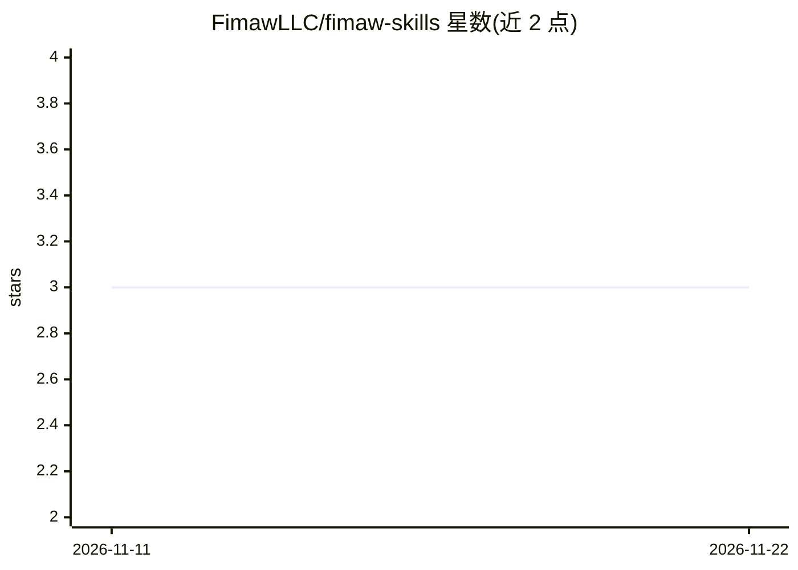

# FimawLLC/fimaw-skills

⭐ 3 · Python · 推送 2026-10-30 · [GitHub](https://github.com/FimawLLC/fimaw-skills) · 组织维护

**为 Fimaw Code 及任意 agent 运行时提供的 118 个技能库**

面向 Fimaw Code 与 CLI 的 agent 技能集合，共 118 个生产技能，由 FimawCode 自动加载，也可被其他 agent 运行时使用。技能按索引表组织，覆盖前端/UI 设计（动画、无障碍、设计系统）、文档处理（docx/pdf/pptx/xlsx）、开发规范（Golang 测试、Next.js 模式、Python 性能）、部署运维（Azure、Vercel、Dockerfile）以及工作流程（规划、代码评审、头脑风暴）等领域，每条技能带触发条件描述。

## 筛选速览

| 维度 | 判定 | 备注 |
|---|---|---|
| AI 角色 | `ai-knowledge` | 知识聚合/清单类 |
| 许可风险 | `none` | — |
| 部署形态 | `self-host` | docker 或自建部署 |
| 模型依赖 | — | README 未给出锁定关系 |
| 硬件要求 | — | 无带数字的原话,不猜 |
| 安装摩擦 | `low` | 无编译、无系统依赖或容器化 |
| 成熟度 | — | 结构信号不足 |

## 能力要点

- 118 个带触发条件描述的 agent 技能
- 由 FimawCode 自动加载，兼容任意 agent 运行时
- 覆盖设计、文档、部署、测试等多领域
- 含 mcp-builder 等构建 MCP 服务器的指导技能

## 适用场景

- 为我的 coding agent 补充前端设计与动画技能
- 让 agent 处理 Word/PDF/PPT/Excel 文档操作
- 按最佳实践指导 Next.js/Golang/Python 项目开发
- 为 agent 配置 Azure 或 Vercel 部署流程

## 场景标签

`提示工程` · 领域:Agent 开发

## 证据(README 行号)

> L7: **118 production-ready agent skills** for the Fimaw Code & CLI
> L9: Loaded automatically by FimawCode and usable by any agent runtime.
> L11: ## Index

## 星数曲线

2026-11-11 3 → 2026-11-22 3（+0）

---
*卡片 v1 · prompt 1.4 · 生成 2026-11-22 · 置信度 mid · 依据 README sha `60669aa75399` · [字段定义](../../DATASET.md)*
