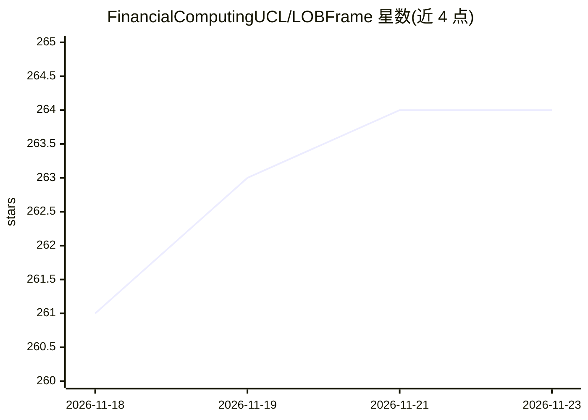

# FinancialComputingUCL/LOBFrame

⭐ 264 · Python · 推送 2026-11-17 · [GitHub](https://github.com/FinancialComputingUCL/LOBFrame) · 组织维护

**限价订单簿（LOB）深度学习预测的实验复现框架**

配合两篇论文发布的开源代码库：提供从 LOBSTER 格式原始数据预处理、torch 数据集构建、模型训练/验证/测试，到交易模拟回测与结果分析的全流程管道。内置 deeplob、transformer、hlob 等 11 种模型，通过单一入口命令按阶段执行，支持多阶段组合与按 experiment_id 恢复实验。要求插入 Weights & Biases 项目名与 API key，数据依赖 LOBSTER 数据。面向科研人员复现或开展金融市场高频预测实验。

## 筛选速览

| 维度 | 判定 | 备注 |
|---|---|---|
| AI 角色 | `ai-native` | 本体是模型或模型工具 |
| 许可风险 | `none` | — |
| 部署形态 | `library` | 以包/库形式分发 |
| 模型依赖 | — | README 未给出锁定关系 |
| 硬件要求 | — | 无带数字的原话,不猜 |
| 安装摩擦 | `low` | 无编译、无系统依赖或容器化 |
| 成熟度 | — | 结构信号不足 |

## 能力要点

- 数据预处理→训练→评估→回测→交易后分析的全流程管道
- 内置 11 种模型（deeplob、transformer、itransformer、hlob 等）
- HLOB 模型支持同调结构准备阶段
- 实验可通过 experiment_id 恢复重跑

## 适用场景

- 复现 Deep LOB Forecasting 与 HLOB 两篇论文的实验
- 在 LOBSTER 数据上训练并对比多种 LOB 预测模型
- 通过交易模拟回测评估模型输出质量

## 场景标签

`金融量化` `科研工具` · 领域:学习与行业

## 证据(README 行号)

> L3: We release `LOBFrame` (see the two papers `Deep Limit Order Book Forecasting` and `HLOB - Information Persistence an
> L7: In this tutorial, we show how to replicate the experiments presented in the two papers titled __"Deep Limit Order Bo
> L73:  Currently available models are:

## 星数曲线

2026-11-18 261 → 2026-11-23 264（+3）

---
*卡片 v1 · prompt 1.4 · 生成 2026-11-18 · 置信度 mid · 依据 README sha `692a94b0a518` · [字段定义](../../DATASET.md)*
