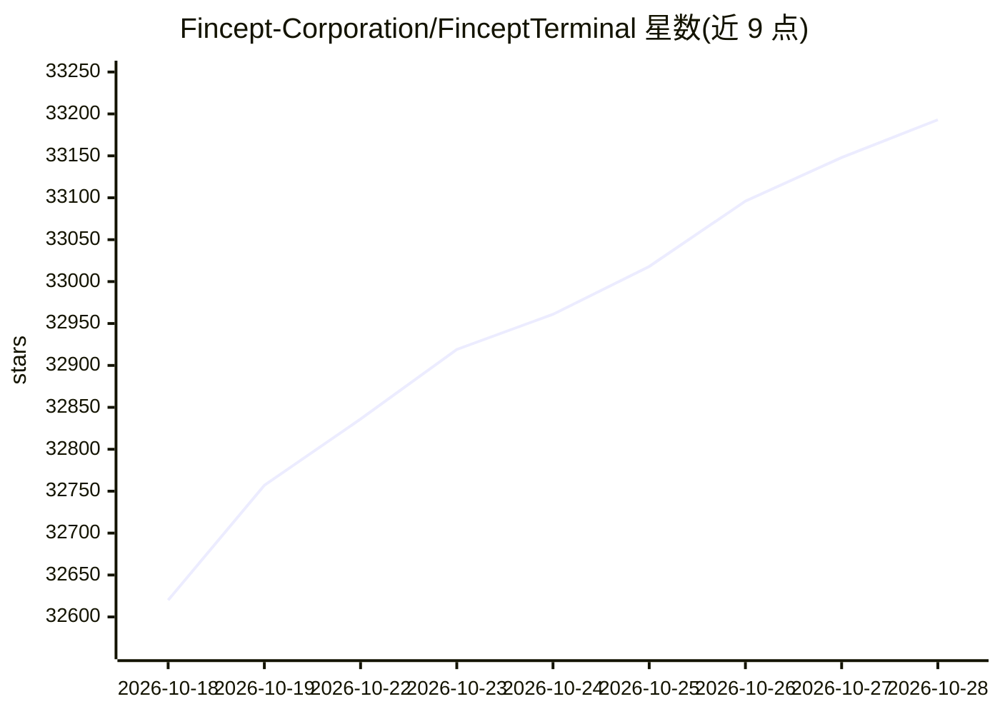

# Fincept-Corporation/FinceptTerminal

⭐ 33,193 · C++ · NOASSERTION · 推送 2026-10-26 · [GitHub](https://github.com/Fincept-Corporation/FinceptTerminal) · [官网](https://fincept.in) · 组织维护

**开源 C++ 金融研究终端：面向投资者/研究者的市场分析与 AI 自动化**

原生 C++20/Qt6 桌面金融终端，嵌入 Python 3.11 分析，单一二进制。开源版（AGPL-3.0）提供 DCF、投资组合优化、VaR/Sharpe 等分析模块，37 个交易/经济/地缘 agent（自带 LLM key），100+ 数据连接器（FRED、IMF、Polygon 等），纸面交易引擎与 16 家券商集成，可视化节点编辑器与 MCP 工具。另有闭源 Enterprise 版按月付费，团队日常开发在 Enterprise，本仓库每月发布一次。

## 筛选速览

| 维度 | 判定 | 备注 |
|---|---|---|
| AI 角色 | `ai-enhanced` | 去掉 AI 部分产品仍成立 |
| 许可风险 | `dual` | NOASSERTION |
| 部署形态 | `desktop` | 安装包/桌面程序 |
| 模型依赖 | local-ok | 支持本地模型 |
| 硬件要求 | — | 无带数字的原话,不猜 |
| 安装摩擦 | `medium` | 含编译或系统依赖之一 |
| 成熟度 | — | 结构信号不足 |

## 动量与使用信号

- 维护:`active` — 距上次 push 5.0 天,年发版 27,42 位贡献者
- 涨星:近 1 天 **+64**(自 20261016 起算)
- 下载:GitHub Release 附件 累计 106,151(34 个 release)
- 平台:— · 协议:MCP / OLLAMA

## 能力要点

- 37 个 trader/economic/geopolitics agents，支持 OpenAI、Anthropic、Gemini、Groq、DeepSeek、OpenRouter、Ollama 等 key
- 100+ 数据连接器（FRED、IMF、World Bank、Polygon、AkShare 等）
- 16 家券商集成与纸面交易引擎
- 原生 C++20/Qt6，单二进制，无 Electron/Node.js

## 适用场景

- 学生与学术研究者做股票基本面与量化分析学习
- 通过自带 LLM key 运行金融研究 agent
- 连接个人 API key 获取市场与宏观数据
- 用纸面交易引擎模拟加密与股票交易策略

## 场景标签

`金融量化` `科研工具` · 领域:学习与行业

## 证据(README 行号)

> L65: **Fincept Terminal** is a native C++20 desktop terminal for financial research — Qt6 UI, embedded Python 3.11 analy
> L119: - **Analytics** — DCF, portfolio optimisation, VaR/Sharpe, derivatives pricing, fixed income, alternatives, plus a
> L120: - **AI** — 37 trader/investor, economic and geopolitics agents; bring your own key (OpenAI, Anthropic, Gemini, Gro

## 星数曲线

2026-10-18 32,620 → 2026-10-28 33,193（+573）

---
*卡片 v1 · prompt 1.4 · 生成 2026-10-18 · 置信度 high · 依据 README sha `84203647465b` · [字段定义](../../DATASET.md)*
