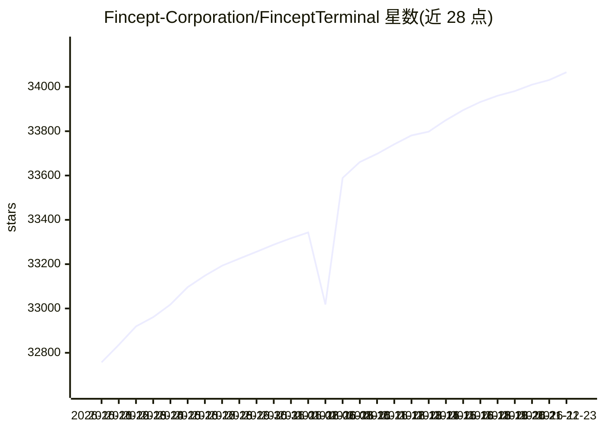

# Fincept-Corporation/FinceptTerminal

⭐ 34,066 · C++ · AGPL-3.0 · 推送 2026-11-19 · [GitHub](https://github.com/Fincept-Corporation/FinceptTerminal) · [官网](https://fincept.in) · 组织维护

**开源 C++ 金融终端：行情分析、投研、交易与 AI agent**

本地运行的 C++20/Qt6 桌面金融研究终端，内嵌 Python 3.11，单二进制分发。开源版提供 DCF、投资组合优化、VaR/Sharpe 等分析，37 个金融/地缘 agent（自带 LLM key）、100+ 数据连接器、16 家券商集成、节点编辑器与 AI Quant Lab。AGPL-3.0 许可，每月发布一个版本；另有闭源付费 Enterprise 版，AI 数据需用户自备 key，行情来自用户自己的数据源。

## 筛选速览

| 维度 | 判定 | 备注 |
|---|---|---|
| AI 角色 | `ai-enhanced` | 去掉 AI 部分产品仍成立 |
| 许可风险 | `dual` | AGPL-3.0 |
| 部署形态 | `desktop` | 安装包/桌面程序 |
| 模型依赖 | local-ok | 支持本地模型 |
| 硬件要求 | — | 无带数字的原话,不猜 |
| 安装摩擦 | `medium` | 含编译或系统依赖之一 |
| 成熟度 | — | 结构信号不足 |

## 动量与使用信号

- 维护:`active` — 距上次 push 5.0 天,年发版 27,42 位贡献者
- 涨星:近 1 天 **+64**(自 20261016 起算)
- 下载:GitHub Release 附件 累计 106,151(34 个 release)
- 平台:— · 协议:MCP / OLLAMA

## 能力要点

- 37 个交易/经济/地缘 agent，支持 OpenAI、Anthropic、Gemini、Groq、DeepSeek、OpenRouter、Ollama 等自带 key
- 100+ 数据连接器（FRED、IMF、World Bank、AkShare、Polygon 等）与 16 家券商集成
- C++20/Qt6 单二进制桌面应用，无 Electron/Node.js
- 18 模块 QuantLib 套件与 AI Quant Lab（ML、因子发现、RL）

## 适用场景

- 自备 API key 做个股与宏观经济研究
- 用自带券商账户进行模拟与实盘交易
- 学习量化分析、回测与因子研究
- 教学与学术场景下的金融数据分析

## 场景标签

`金融量化` · 领域:学习与行业

## 证据(README 行号)

> L85: **Fincept Terminal** is a native C++20 desktop terminal for financial research — Qt6 UI, embedded Python 3.11 analy
> L139: - **AI** — 37 trader/investor, economic and geopolitics agents; bring your own key (OpenAI, Anthropic, Gemini, Gro
> L87: Two editions run on one data core. **Enterprise** is the private, closed-source build the team develops daily, for 

## 星数曲线

2026-10-21 32,757 → 2026-11-23 34,066（+1,309）

---
*卡片 v1 · prompt 1.4 · 生成 2026-11-22 · 置信度 high · 依据 README sha `32e02a22b432` · [字段定义](../../DATASET.md)*
