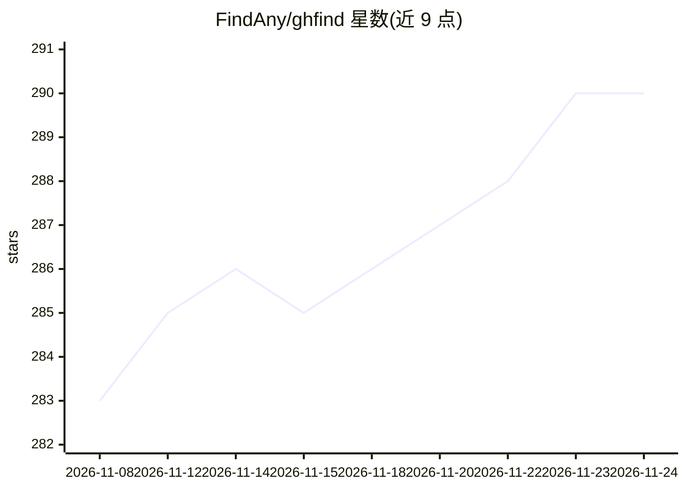

# FindAny/ghfind

⭐ 292 · TypeScript · AGPL-3.0 · 推送 2026-11-22 · [GitHub](https://github.com/FindAny/ghfind) · [官网](https://ghfind.com) · 个人维护 · 中文 README

**基于公开 GitHub 数据的开发者 0–100 评分与发现平台**

读取公开 GitHub 数据，用确定性规则在六个维度上计算开发者 0–100 评分，附等级、风险信号（刷星/fork 圈地、PR 洪水、机器人）与可选的 AI 文字报告；AI 不改变分数。面向招聘方、维护者与开发者本人，提供排行榜、档案徽章、GitHub App（按分数段标注 issue/PR）、REST API、MCP 服务与 JS/Python SDK 及 Go CLI。评分公式开源为 scoring/ 模块（TypeScript/Go/Python 三实现共享 fixtures），可本地复算；仅覆盖公开数据，私有贡献不计入。自托管采用 AGPL-3.0。

## 筛选速览

| 维度 | 判定 | 备注 |
|---|---|---|
| AI 角色 | `ai-enhanced` | 去掉 AI 部分产品仍成立 |
| 许可风险 | `viral` | AGPL-3.0 |
| 部署形态 | `library` | 以包/库形式分发 |
| 模型依赖 | — | README 未给出锁定关系 |
| 硬件要求 | — | 无带数字的原话,不猜 |
| 安装摩擦 | `low` | 无编译、无系统依赖或容器化 |
| 成熟度 | — | 结构信号不足 |

## 能力要点

- 确定性六维评分 + 封顶风险规则，同一证据同一版本结果相同
- AI 仅生成标签与文字报告，不改变分数
- scoring/ 模块开源，SDK 可本地复算任意已发布扫描
- 提供 REST API、MCP 服务、JS/Python SDK、Go CLI 与 GitHub App

## 适用场景

- 输入 GitHub handle 查看 0–100 评分、等级与风险信号
- 招人时浏览开发者排行榜或对比两名候选人
- 在仓库 issue/PR 上自动标注作者分数段辅助分诊
- 通过 MCP/SDK 把开发者评分接入 agent 或自己的工具链

## 场景标签

 · 领域:开发者工具/代码质量评估

## 证据(README 行号)

> L33: - **AI never changes the number.** The report model writes tags and prose from the fixed score.
> L15: - **Measure.** Enter a GitHub handle to get a deterministic **0–100 score** across six dimensions, a level and rati

## 星数曲线

2026-11-08 283 → 2026-11-24 290（+7）

---
*卡片 v1 · prompt 1.4 · 生成 2026-11-17 · 置信度 mid · 依据 README sha `127b4acd5ffa` · [字段定义](../../DATASET.md)*
