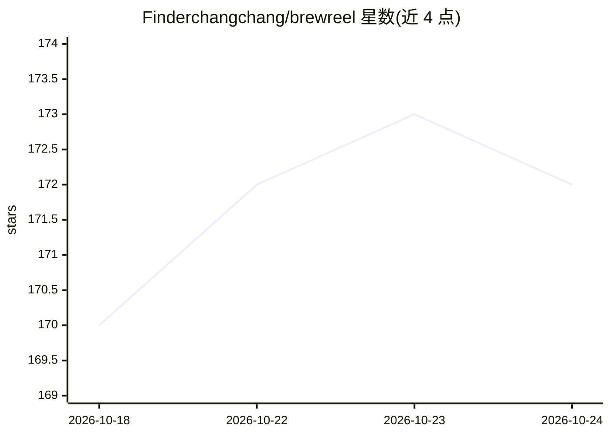

# Finderchangchang/brewreel

⭐ 172 · JavaScript · Apache-2.0 · 推送 2026-10-12 · [GitHub](https://github.com/Finderchangchang/brewreel) · [官网](https://brewreel.com) · 个人维护 · 中文 README

**用便宜 LLM 也能一条命令出竖版宣传/口播/讲课视频的工具**

基于 Remotion 的视频生成工具：输入产品简报、口播 mp4 或讲稿 JSON，输出竖版宣传片、配画面口播和 16:9 讲课视频。核心机制是让便宜模型只填 storyboard/broll/lesson JSON 表单而不写代码；出片前先跑广告法、行业规则、数字出处等校验，有一项不过不出片。内置 3 种配方、6 个行业、本机 SenseVoice 转写；AI 画面与付费配音需人工估价审批。自述仍为预览版，阿里云/火山引擎配音及 DeepSeek Harness 插件未真实跑通。

## 筛选速览

| 维度 | 判定 | 备注 |
|---|---|---|
| AI 角色 | `ai-native` | 本体是模型或模型工具 |
| 许可风险 | `permissive` | Apache-2.0 |
| 部署形态 | `library` | 以包/库形式分发 |
| 模型依赖 | locked-api |  |
| 硬件要求 | — | 无带数字的原话,不猜 |
| 安装摩擦 | `medium` | 含编译或系统依赖之一 |
| 成熟度 | `idea` | |

## 能力要点

- 便宜模型只填 JSON 表单即可出片，无需写代码
- 广告法/行业规则/数字出处校验，不通过不出片
- 本机 SenseVoice（sherpa-onnx）转写口播
- 3 种配方、6 个行业、配音可选 MiniMax/阿里云/火山引擎

## 适用场景

- 给产品快速做一条 9:16 竖版宣传片初稿
- 给已录口播视频自动配动效卡片或 AI 画面
- 把讲稿生成 16:9 讲解课或普法课程
- 通过 Claude Code / DeepSeek Harness 用对话改分镜再出片

## 场景标签

`视频生成` `语音识别` · 领域:内容生成

## 证据(README 行号)

> L13: **宣传片**：一份产品简报 → 竖版宣传片（9:16）
> L20: **便宜模型只填表，不写代码。** 宣传片填 `storyboard.json`，口播填 `broll.json`，讲课填 `lesson.json`：挑版式、填文字。所以 DeepSeek 这类模型也能出合格片。
> L95: - 本机用 SenseVoice（FunAudioLLM / 阿里通义实验室，由 sherpa-onnx 运行）转写。已有 `talk.srt` 不会被覆盖。

## 星数曲线

2026-10-18 170 → 2026-10-24 172（+2）

---
*卡片 v1 · prompt 1.4 · 生成 2026-10-22 · 置信度 high · 依据 README sha `65c4b35d880c` · [字段定义](../../DATASET.md)*
