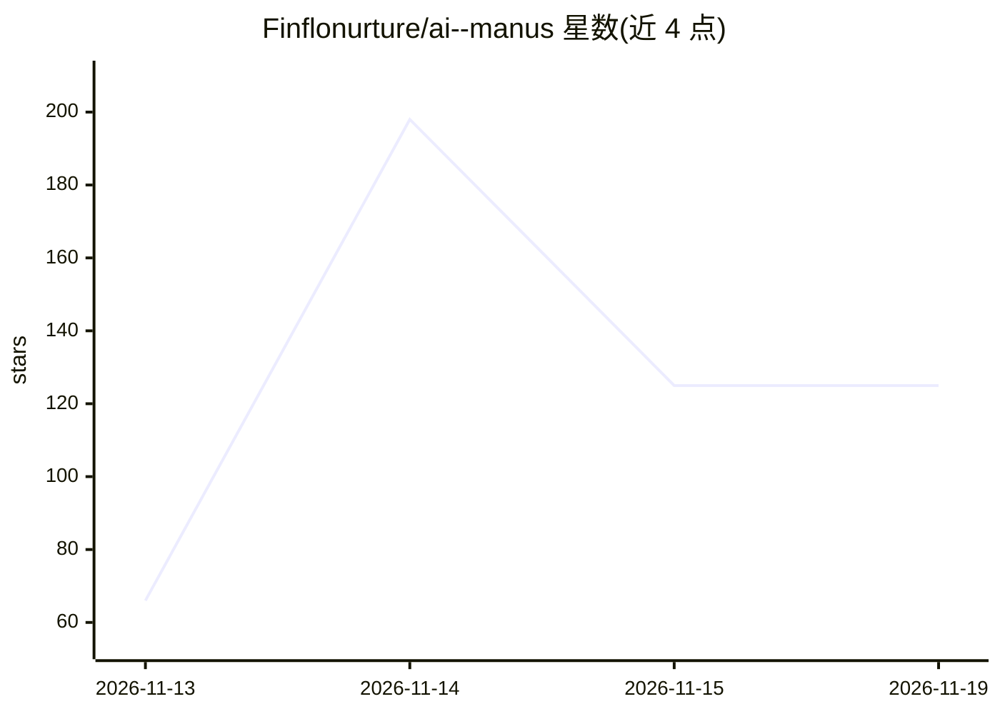

# Finflonurture/ai--manus

⭐ 125 · Apache-2.0 · 推送 2026-11-15 · [GitHub](https://github.com/Finflonurture/ai--manus) · 个人维护

**面向个人日常任务的自主 AI Agent，可执行代码并控制浏览器**

README 描述的 Manus 是一个自主 AI Agent：代替用户编写并执行脚本、控制浏览器导航网页、填表单、采集信息，执行多步骤任务；定位为个人助理，服务于学习、家庭项目与轻量办公，而非企业平台。给出最低/推荐硬件表（4GB 内存起步、推荐 8GB+）与六步上手流程（准备、配置、测试、细化、应用、维护）。README 未提供安装命令、依赖说明或代码仓库结构，仅以功能介绍和使用建议为主。

## 筛选速览

| 维度 | 判定 | 备注 |
|---|---|---|
| AI 角色 | `ai-native` | 本体是模型或模型工具 |
| 许可风险 | `permissive` | Apache-2.0 |
| 部署形态 | `None` |  |
| 模型依赖 | — | README 未给出锁定关系 |
| 硬件要求 | — | 无带数字的原话,不猜 |
| 安装摩擦 | `low` | 无编译、无系统依赖或容器化 |
| 成熟度 | — | 结构信号不足 |

## 能力要点

- 自主执行代码与脚本完成多步骤任务
- 浏览器控制：导航网页、填写表单、采集信息
- 代码与浏览器操作可在同一任务流中衔接
- 面向个人/学生/远程工作者的后台助理定位

## 适用场景

- 整理研究资料、运行小脚本等学习任务
- 让代理代替我在多个网页间采集信息
- 处理日常重复性小任务以减少手工操作

## 场景标签

`AI 助手` `编码 Agent` `浏览器自动化` · 领域:效率与自动化

## 证据(README 行号)

> L10: - **Autonomous Code Execution:** Manus AI agent runs code on its own to complete tasks, so you can focus on decisio
> L18: Manus is an autonomous AI agent designed to run code and control a browser on your behalf. Instead of acting like a

## 星数曲线

2026-11-13 66 → 2026-11-19 125（+59）

---
*卡片 v1 · prompt 1.4 · 生成 2026-11-17 · 置信度 mid · 依据 README sha `67c3d4d92b69` · [字段定义](../../DATASET.md)*
