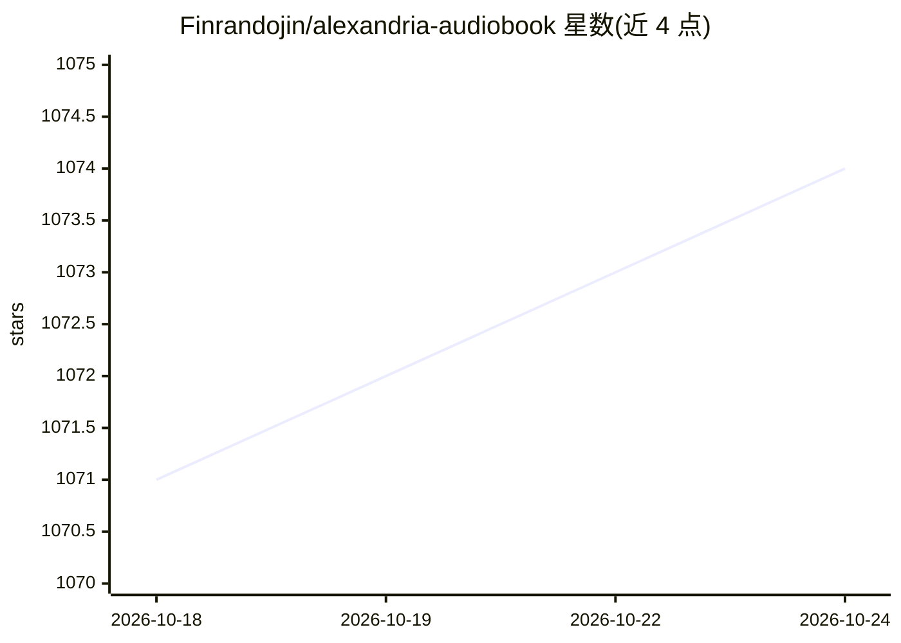

# Finrandojin/alexandria-audiobook

⭐ 1,074 · Python · MIT · 推送 2026-08-02 · [GitHub](https://github.com/Finrandojin/alexandria-audiobook) · 个人维护 · 中文 README

**把书籍/小说转为多角色配音有声书的全流程生成器**

基于 Qwen3-TTS 的本地有声书生成工具：用户连接自选的 OpenAI 兼容 LLM 服务（LM Studio/Ollama/OpenAI 等）做脚本标注，自动切分说话人与台词并生成语音指令；配音方式含 9 种预设音色、5-15 秒参考音频的声音克隆、文本描述生成音色，以及基于自建数据集的 LoRA 声音微调。提供浏览器编辑器逐行修改、批量渲染（声称 3-6 倍实时），可导出 MP3、章节化 M4B 或 Audacity 多轨工程。运行需 8GB+ VRAM GPU（CPU 模式可用但慢），TTS 模型首次使用时下载约 3.5GB/变体；需自备 LLM 服务。

## 筛选速览

| 维度 | 判定 | 备注 |
|---|---|---|
| AI 角色 | `ai-native` | 本体是模型或模型工具 |
| 许可风险 | `permissive` | MIT |
| 部署形态 | `self-host` | docker 或自建部署 |
| 模型依赖 | local-ok | 支持本地模型 |
| 硬件要求 | `gpu-8g` | |
| 安装摩擦 | `low` | 无编译、无系统依赖或容器化 |
| 成熟度 | `idea` | |

## 能力要点

- LLM 自动脚本标注：说话人、对话、TTS 指令 JSON，可选二次 LLM 校对
- 内置 Qwen3-TTS 本地引擎，支持克隆/设计/LoRA 微调音色
- 11 种语言支持与逐行 instruct 情绪控制
- 导出章节化 M4B/MP3/Audacity 多轨工程

## 适用场景

- 把 txt/epub 小说转成多角色配音的有声书
- 自建数据集微调专属音色用于有声书制作
- 在 Audiobookshelf/Apple Books 等播放器使用生成的章节化有声书

## 场景标签

`语音合成` `微调` · 领域:内容生成

## 证据(README 行号)

> L9: Transform any book or novel into a fully-voiced audiobook using AI-powered script annotation and text-to-speech. Fea
> L29: - **Built-in TTS Engine** - Qwen3-TTS runs locally with no external server required
> L33: - **Voice Cloning** - Clone any voice from a 5-15 second reference audio sample

## 星数曲线

2026-10-18 1,071 → 2026-10-24 1,074（+3）

---
*卡片 v1 · prompt 1.4 · 生成 2026-10-21 · 置信度 high · 依据 README sha `f3995f0dbf47` · [字段定义](../../DATASET.md)*
