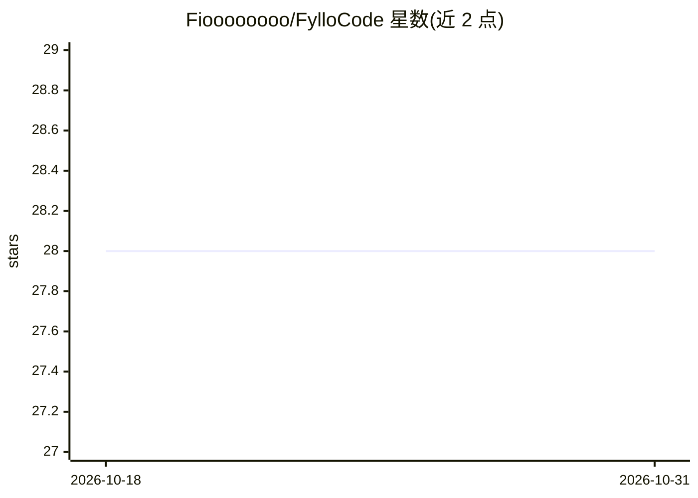

# Fioooooooo/FylloCode

⭐ 28 · TypeScript · MIT · 推送 2026-09-24 · [GitHub](https://github.com/Fioooooooo/FylloCode) · [官网](https://fyllocode.cc) · 个人维护 · 中文 README

**桌面应用：把本地 Coding Agent 接入项目治理与决策留档工作流**

基于 Electron·Vue 3 的开源桌面应用，通过 ACP 协议接入 Claude Code、Codex 等本地 Coding Agent，在其上叠加持久化项目治理层：fyllo-specs MCP 服务器向 Agent 注入项目规范，fyllo-cortex 维护 guidelines 与 Workspace knowledge，fyllo-spawn 支持跨 Agent 委派。任务沿 Task→Chat→Plan/Proposal→Apply & Archive 推进，决策与弃置理由以 lineage 结构化留档，任务默认运行在独立 Git worktree。任务结果可回写研发系统（云效已集成，GitHub/Jira 等计划中）。提供 macOS/Windows/Linux 安装包。

## 筛选速览

| 维度 | 判定 | 备注 |
|---|---|---|
| AI 角色 | `ai-ecosystem` | LLM/agent 周边工具 |
| 许可风险 | `permissive` | MIT |
| 部署形态 | `None` |  |
| 模型依赖 | — | README 未给出锁定关系 |
| 硬件要求 | — | 无带数字的原话,不猜 |
| 安装摩擦 | `low` | 无编译、无系统依赖或容器化 |
| 成熟度 | — | 结构信号不足 |

## 能力要点

- fyllo-specs 向所有 Agent 暴露按 Project 归属的规范，跨会话跨 Agent 生效
- Task→Chat→Proposal→Apply & Archive 全程 lineage 追溯
- 每任务运行独立 Git worktree，超边界修改被拦截
- guidelines 与 knowledge 卡片机制沉淀工程约定，需用户确认后写入

## 适用场景

- 让不同 Coding Agent 在同一项目里遵守统一的架构与命名规范
- 追溯某次代码变更当时的设计依据与被否决方案
- 把任务结果回写 GitHub、云效等已有研发系统

## 场景标签

`工作流自动化` `知识库管理` · 领域:效率与自动化

## 证据(README 行号)

> L6:  开源桌面应用，把 Claude Code、Codex 等本地 Coding Agent 接进项目工作流
> L38: |**统一规范**|`fyllo-specs` MCP 服务器向所有 Agent 暴露按 Project 归属的规范，在 Workspace 内跨会话、跨 Agent 持续生效|
> L162: |Agent 协议|Agent Client Protocol (ACP)|

## 星数曲线

2026-10-18 28 → 2026-10-31 28（+0）

---
*卡片 v1 · prompt 1.4 · 生成 2026-10-26 · 置信度 high · 依据 README sha `5dec5138f076` · [字段定义](../../DATASET.md)*
