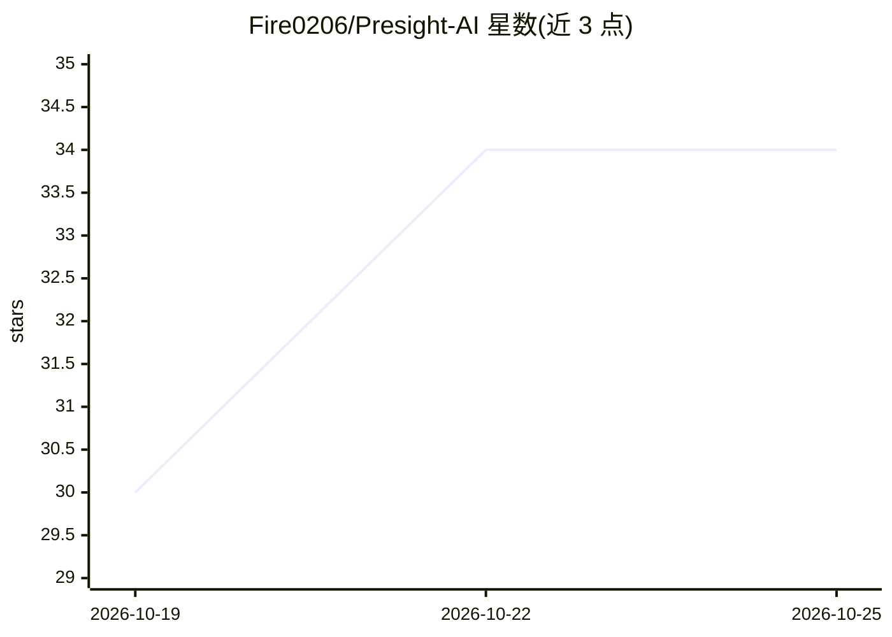

# Fire0206/Presight-AI

⭐ 34 · NOASSERTION · 推送 2026-10-19 · [GitHub](https://github.com/Fire0206/Presight-AI) · [官网](https://presight.cloud) · 个人维护 · 中文 README

**个人投资者的基金股票研究工作台，含 AI 对话与智能体**

面向个人投资者的基金与股票研究工作台：基金中心提供盘中估值参考与走势，股票中心提供行情、K 线与指标，市场热点聚合新闻与行业主题；智能体中心支持创建智能体、配置回答风格、选择 Skills 并以个人资料构建知识库（RAG），对话可结合行情、新闻与用户持仓。仓库含可启动的 Vue 前端与 FastAPI 后端演示，行情数据固定为演示快照，知识资料、Skills 与文件选择在本地版中仅为界面演示，不参与模型请求；模型 API 可在后端 .env 配置 OpenAI 兼容接口且默认关闭。MIT 许可不含品牌素材。

## 筛选速览

| 维度 | 判定 | 备注 |
|---|---|---|
| AI 角色 | `ai-enhanced` | 去掉 AI 部分产品仍成立 |
| 许可风险 | `none` | NOASSERTION |
| 部署形态 | `None` |  |
| 模型依赖 | — | README 未给出锁定关系 |
| 硬件要求 | — | 无带数字的原话,不猜 |
| 安装摩擦 | `low` | 无编译、无系统依赖或容器化 |
| 成熟度 | `idea` | |

## 能力要点

- 基金盘中估值参考、持仓记录与自选管理
- 股票行情、K 线与市场热点新闻浏览
- 智能体创建：回答风格、Skills 与个人知识库（RAG）配置
- 本地演示含 Vue 前端 + FastAPI 后端，API 密钥仅由后端读取

## 适用场景

- 查看基金盘中估值并跟踪自己的基金持仓
- 研究股票行情、K 线与市场热点新闻
- 创建智能体并结合持仓与个人资料做 AI 研究提问

## 场景标签

`金融量化` `RAG` · 领域:知识与检索

## 证据(README 行号)

> L6: 知几是一个面向个人投资者的基金与股票研究工作台。基金中心提供盘中估值参考和走势，股票中心与市场热点补充行情、新闻和板块信息；在 AI 对话中，用户可以围绕自己的持仓提问，也可以创建智能体、选择 Skills，并用个人资料构建知识库（
> L50: - **跟踪基金**：查看盘中估值参考和走势，记录持仓、关注基金。
> L52: - **让 AI 结合上下文分析**：对话可调用行情、新闻等市场资料，并结合用户持仓；可用的能力会按问题需要选择。

## 星数曲线

2026-10-19 30 → 2026-10-25 34（+4）

---
*卡片 v1 · prompt 1.4 · 生成 2026-10-25 · 置信度 mid · 依据 README sha `4fe93b0c5b45` · [字段定义](../../DATASET.md)*
