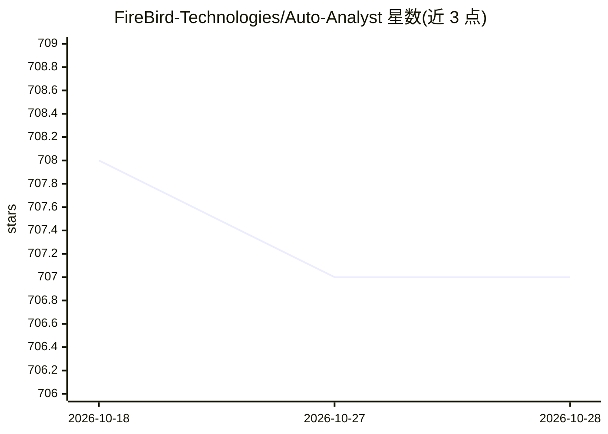

# FireBird-Technologies/Auto-Analyst

⭐ 707 · TypeScript · MIT · 推送 2026-08-20 · [GitHub](https://github.com/FireBird-Technologies/Auto-Analyst) · [官网](https://www.autoanalyst.ai) · 组织维护

**开源 AI 数据科学平台：对话式完成清洗、分析与可视化**

由 Firebird Technologies 开发的模块化 AI 数据科学系统，面向数据科学工作者：上传 CSV/Excel 后以对话方式提问，由内置 agent（预处理、统计分析、scikit-learn 机器学习、Plotly 可视化）或集中式 planner 自动路由并生成代码、结果与图表。Agent 以 dspy.Signature 类实现，可自行扩展；LLM 接口不绑定厂商，使用自有 API key（OpenAI/Anthropic/DeepSeek(groq) 等）。内置 Google Ads、HubSpot、Salesforce、Postgres 等数据连接器；分析仪表盘与定时报告标注为企业版功能。MIT 许可，提供在线试用站点。

## 筛选速览

| 维度 | 判定 | 备注 |
|---|---|---|
| AI 角色 | `ai-native` | 本体是模型或模型工具 |
| 许可风险 | `permissive` | MIT |
| 部署形态 | `None` |  |
| 模型依赖 | — | README 未给出锁定关系 |
| 硬件要求 | — | 无带数字的原话,不猜 |
| 安装摩擦 | `low` | 无编译、无系统依赖或容器化 |
| 成熟度 | — | 结构信号不足 |

## 能力要点

- 四个内置 agent：pandas 预处理、statsmodels 统计检验、scikit-learn 建模、plotly 可视化
- planner 模式自动选 agent、生成计划并协调多 agent 工作流
- Agent 以 dspy.Signature 类实现，可数分钟内添加自定义 agent
- LLM 无关：兼容 OpenAI、Anthropic、DeepSeek(groq) 等任意 API key

## 适用场景

- 上传数据集后用对话完成清洗、统计与机器学习分析
- 通过 planner 自动路由，无需指定 agent 即可获取分析结果
- 接入 Google Ads、HubSpot、Salesforce 等数据源做分析

## 场景标签

`数据分析` `多智能体` · 领域:Agent 开发

## 证据(README 行号)

> L9: Auto-Analyst is a fully open-sourced, modular AI system designed to automate data science workflows — from data clea
> L46: * **@agent\_name** to specify which agent to use (e.g. `@preprocessing_agent`)
> L55: |`@sk_learn_agent`|Trains machine learning models like Random Forest, KMeans, Logistic Regression using `scikit-lea

## 星数曲线

2026-10-18 708 → 2026-10-28 707（-1）

---
*卡片 v1 · prompt 1.4 · 生成 2026-10-21 · 置信度 high · 依据 README sha `69d5b4fb808f` · [字段定义](../../DATASET.md)*
