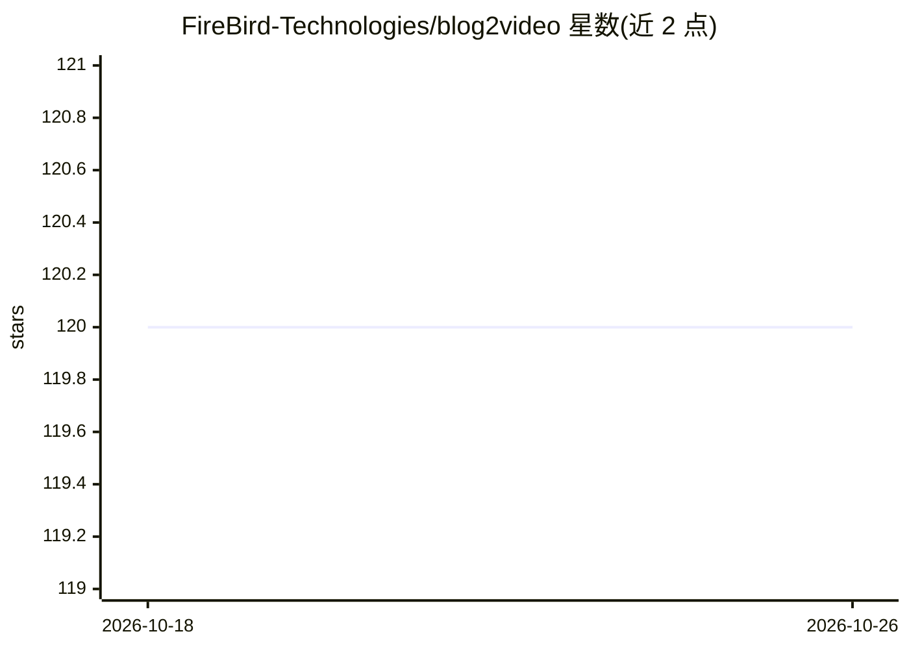

# FireBird-Technologies/blog2video

⭐ 120 · TypeScript · 推送 2026-10-23 · [GitHub](https://github.com/FireBird-Technologies/blog2video) · [官网](https://blog2video.app) · 组织维护

**把博客文章自动转换为 AI 生成视频的在线工具**

Blog2Video 是一个面向内容创作者的博客转视频应用：用户粘贴博客 URL，系统自动生成视频脚本、动画场景与配音，随后可在编辑器中修改任意场景的文字、动画与配音，AI 对话式编辑可辅助调整脚本。提供多种预置模板（叙事、宣传、讲解、营销）并支持自定义模板；批量生成与自定义声音为付费功能。应用通过 Google 登录使用，以 Hugging Face Space（Docker、端口 7860）形式部署，输出可直接发布的视频。

## 筛选速览

| 维度 | 判定 | 备注 |
|---|---|---|
| AI 角色 | `ai-native` | 本体是模型或模型工具 |
| 许可风险 | `none` | — |
| 部署形态 | `None` |  |
| 模型依赖 | — | README 未给出锁定关系 |
| 硬件要求 | — | 无带数字的原话,不猜 |
| 安装摩擦 | `low` | 无编译、无系统依赖或容器化 |
| 成熟度 | — | 结构信号不足 |

## 能力要点

- 粘贴博客 URL 自动生成脚本、场景动画与配音
- 多套预置视频模板与自定义模板能力
- 场景级自由编辑与自然语言命令的 AI 辅助编辑
- 批量生成与自定义声音为付费用户功能

## 适用场景

- 把博客文章快速转成可发布到 YouTube 或社交媒体的视频
- 内容营销活动中批量生成系列视频
- 按品牌风格定制模板并复用保持风格一致

## 场景标签

`视频生成` `语音合成` · 领域:内容生成

## 证据(README 行号)

> L46: - Automatically generates a video script from your blog content.
> L52: - AI handles script writing, scene generation, animations, and voiceovers automatically.

## 星数曲线

2026-10-18 120 → 2026-10-26 120（+0）

---
*卡片 v1 · prompt 1.4 · 生成 2026-10-23 · 置信度 mid · 依据 README sha `a962c3ca2f34` · [字段定义](../../DATASET.md)*
