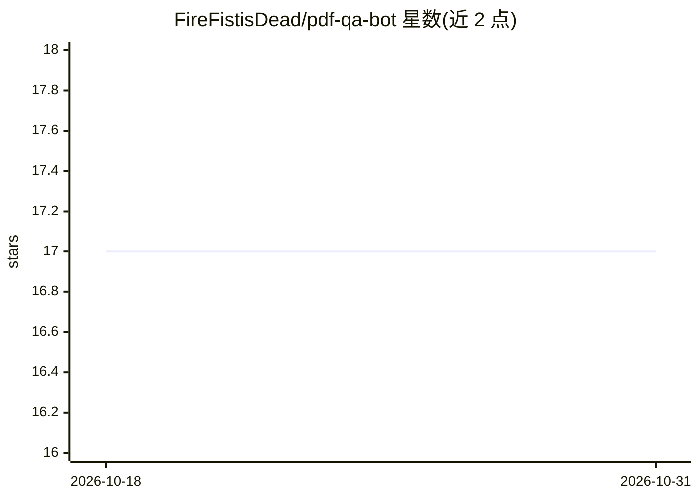

# FireFistisDead/pdf-qa-bot

⭐ 17 · JavaScript · MIT · 推送 2026-09-09 · [GitHub](https://github.com/FireFistisDead/pdf-qa-bot) · 个人维护

**本地三服务 RAG 应用：上传 PDF 并基于其内容问答**

由 React 前端、Express API 网关和 FastAPI RAG 服务组成的多服务应用：上传 PDF 后由服务端解析分块，用 sentence-transformers/all-MiniLM-L6-v2 生成嵌入并建立 FAISS 索引，检索相关片段后由可配置的本地 Hugging Face 模型（默认 flan-t5-base）生成回答或摘要。支持多种回答风格、多文档切换、页内 PDF 预览与对话导出。向量索引存于进程内存，重启即丢失；可通过 Docker Compose 一键部署，模型缓存在持久卷中。

## 筛选速览

| 维度 | 判定 | 备注 |
|---|---|---|
| AI 角色 | `ai-native` | 本体是模型或模型工具 |
| 许可风险 | `permissive` | MIT |
| 部署形态 | `self-host` | docker 或自建部署 |
| 模型依赖 | — | README 未给出锁定关系 |
| 硬件要求 | `cpu-ok` | |
| 安装摩擦 | `low` | 无编译、无系统依赖或容器化 |
| 成熟度 | — | 结构信号不足 |

## 能力要点

- PDF 上传→分块→FAISS 向量索引→本地 HF 模型生成回答
- 五种回答风格（Standard/Tutor/Socratic/Simple/Concise）
- 多文档上传切换、页内 PDF 预览、对话导出 CSV/文本
- Docker Compose 整栈部署，模型缓存于持久卷

## 适用场景

- 本地部署对 PDF 文档做基于内容的问答与摘要
- 以不同讲解风格（辅导/苏格拉底式）理解文档内容
- 通过 Docker 一键运行完整 RAG 应用栈

## 场景标签

`文档问答` · 领域:知识与检索

## 证据(README 行号)

> L6: Upload PDF documents, ask natural-language questions grounded in their content, and generate concise summaries — all
> L36: 2. **Index** — FastAPI loads the PDF with LangChain, splits text into chunks, embeds them with `sentence-transforme
> L37: 3. **Ask / Summarize** — The UI includes `session_id` on each request. FastAPI retrieves relevant chunks, builds a 

## 星数曲线

2026-10-18 17 → 2026-10-31 17（+0）

---
*卡片 v1 · prompt 1.4 · 生成 2026-10-30 · 置信度 high · 依据 README sha `a4f6bdcacc72` · [字段定义](../../DATASET.md)*
