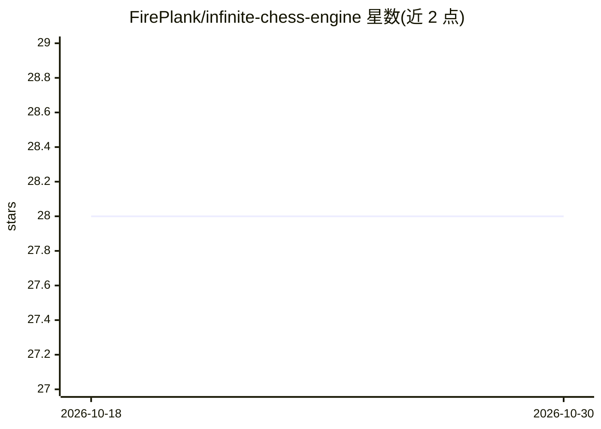

# FirePlank/infinite-chess-engine

⭐ 28 · Rust · GPL-3.0 · 推送 2026-10-29 · [GitHub](https://github.com/FirePlank/infinite-chess-engine) · 个人维护

**为 Infinite Chess 网站编写的无限棋盘 Rust 国际象棋引擎**

用 Rust 编写并编译为 WebAssembly 的国际象棋引擎，面向 infinitechess.org 的无限棋盘变体：在 i64 坐标上处理任意大小棋盘，超界局面加载时压缩并在走子后映射回原位。搜索采用迭代加深 PVS、期望窗口、空着裁剪与 LMR；评估为模块化 HCE 加小型量化网络修正项。支持 Lazy SMP 多线程（需 COOP/COEP 头）与所有仙子棋子及变体，提供 JavaScript API 与 cargo/wasm-pack 构建、SPRT 强度测试流程。GPL-3.0 许可。

## 筛选速览

| 维度 | 判定 | 备注 |
|---|---|---|
| AI 角色 | `ai-native` | 本体是模型或模型工具 |
| 许可风险 | `viral` | GPL-3.0 |
| 部署形态 | `library` | 以包/库形式分发 |
| 模型依赖 | — | README 未给出锁定关系 |
| 硬件要求 | — | 无带数字的原话,不猜 |
| 安装摩擦 | `low` | 无编译、无系统依赖或容器化 |
| 成熟度 | — | 结构信号不足 |

## 能力要点

- i64 无限棋盘坐标，超界局面压缩加载并映射回原位
- 迭代加深 PVS 搜索：期望窗口、空着裁剪、LMR、历史启发排序
- 模块化 HCE 评估加小型量化神经网络修正
- Lazy SMP 多线程（WASM 线程池需特定 HTTP 头）

## 适用场景

- 在 infinitechess.org 上与引擎对弈无限棋盘变体
- 通过 JavaScript API 在网页中嵌入无限棋引擎
- 用 SPRT 工具验证引擎棋力提升

## 场景标签

 · 领域:游戏/博弈引擎

## 证据(README 行号)

> L3: A Rust chess engine compiled to WebAssembly, designed for Infinite Chess.
> L25: - **Evaluation**: Modular HCE (Material, Cloud Centrality, Pawn Advancement, King Safety, etc.) plus a small quanti

## 星数曲线

2026-10-18 28 → 2026-10-30 28（+0）

---
*卡片 v1 · prompt 1.4 · 生成 2026-10-26 · 置信度 mid · 依据 README sha `690e062c097b` · [字段定义](../../DATASET.md)*
