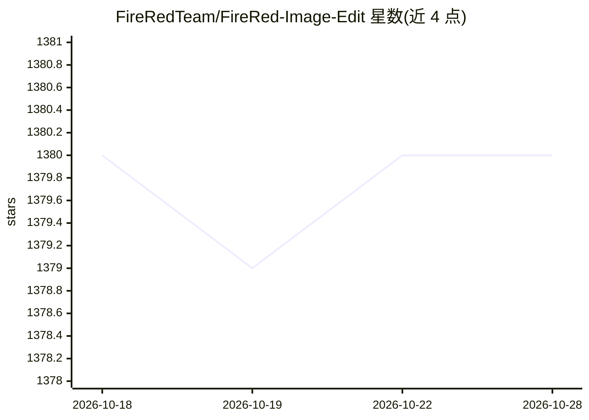

# FireRedTeam/FireRed-Image-Edit

⭐ 1,380 · Python · Apache-2.0 · 推送 2026-04-03 · [GitHub](https://github.com/FireRedTeam/FireRed-Image-Edit) · 组织维护 · 中文 README

**开源图像编辑基础模型：按指令高保真编辑与多元素融合**

FireRedTeam 发布的通用图像编辑扩散模型（1.0/1.1/蒸馏版），基于文本到图像底座经 Pretrain→SFT→RL 注入编辑能力，支持指令跟随编辑、人物一致性保持、多图融合、人像妆容、文字风格参考与老照片修复。原生支持 1–3 张输入图，超过 3 张时由 Agent 模块做 ROI 检测、裁剪拼接与指令改写（LLM 可选，ROI 检测固定用 Gemini）。开放 LoRA 训练代码与加速套件，轻量推理需 30GB 显存、约 4.5 秒/张；支持 ComfyUI 节点与 GGUF 格式。代码与权重均按 Apache 2.0 许可。

## 筛选速览

| 维度 | 判定 | 备注 |
|---|---|---|
| AI 角色 | `ai-native` | 本体是模型或模型工具 |
| 许可风险 | `permissive` | Apache-2.0 |
| 部署形态 | `library` | 以包/库形式分发 |
| 模型依赖 | local-ok | 支持本地模型 |
| 硬件要求 | `gpu-24g` | |
| 安装摩擦 | `low` | 无编译、无系统依赖或容器化 |
| 成熟度 | — | 结构信号不足 |

## 能力要点

- Pretrain→SFT→RL 流程向任意 T2I 底座注入编辑能力，开放 LoRA 训练代码
- 加速套件（蒸馏/量化/静态编译）实现 30GB 显存、约 4.5s/张端到端生成
- Agent 模块自动 ROI 检测、裁剪拼接处理 3 张以上多图编辑，LLM 改写可选
- 原生 ComfyUI 节点与 GGUF 轻量格式部署

## 适用场景

- 按自然语言指令编辑图像并保持人物身份一致
- 多张参考图融合生成新场景（如虚拟试穿）
- 用自有数据训练自定义风格的 LoRA
- 通过 ComfyUI 节点集成到图像生成工作流

## 场景标签

`图像生成` · 领域:内容生成

## 证据(README 行号)

> L22: **FireRed-Image-Edit-1.0** is a general-purpose image editing model that delivers high-fidelity and consistent edit
> L122: python inference.py \
> L272: The code and the weights of FireRed-Image-Edit are licensed under Apache 2.0.

## 星数曲线

2026-10-18 1,380 → 2026-10-28 1,380（+0）

---
*卡片 v1 · prompt 1.4 · 生成 2026-10-21 · 置信度 high · 依据 README sha `b833f2f2c4df` · [字段定义](../../DATASET.md)*
