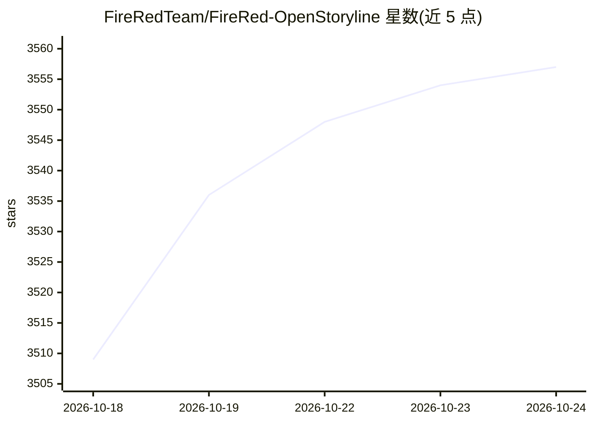

# FireRedTeam/FireRed-OpenStoryline

⭐ 3,557 · Python · Apache-2.0 · 推送 2026-07-31 · [GitHub](https://github.com/FireRedTeam/FireRed-OpenStoryline) · 组织维护 · 中文 README

**自然语言对话驱动的 AI 视频剪辑 Agent**

FireRedTeam 开源的 AI 视频剪辑 Agent：通过自然语言对话完成素材搜索下载、剪辑分割、脚本生成、BGM/配音/字体推荐与转场生成，编辑操作全部经由自然语言指令执行，并可将完整剪辑流程归档为可复用的 Style Skill。以 LLM 规划与工具编排为核心机制，提供 MCP Server 与 CLI/Web 界面，另提供 OpenClaw 与 Claude Code 的 Agent Skills 安装方式。安装需克隆源码、Conda 环境、下载模型资源并 pip 安装依赖，或使用 Docker 镜像；启动前需在 config.toml 配置 API Key，AI 转场功能依赖第三方 AIGC 服务且成本较高。

## 筛选速览

| 维度 | 判定 | 备注 |
|---|---|---|
| AI 角色 | `ai-native` | 本体是模型或模型工具 |
| 许可风险 | `permissive` | Apache-2.0 |
| 部署形态 | `desktop` | 安装包/桌面程序 |
| 模型依赖 | — | README 未给出锁定关系 |
| 硬件要求 | — | 无带数字的原话,不猜 |
| 安装摩擦 | `low` | 无编译、无系统依赖或容器化 |
| 成熟度 | — | 结构信号不足 |

## 能力要点

- 自然语言驱动的剪辑/换序/调色/字幕编辑，即时呈现结果
- 剪辑工作流可归档为 Style Skill，换素材即可复刻风格批量创作
- 智能脚本生成（少样本风格迁移）与 BGM/配音/字体推荐
- ASR 粗剪技能：自动去除口语冗余并按时间戳分段

## 适用场景

- 用对话方式完成种草、开箱、旅行 Vlog 等短视频剪辑
- 把固定剪辑风格保存为 Skill 后批量套用产出
- 对演讲/口播视频做 ASR 自动去废话粗剪

## 场景标签

`语音识别` `图像视频处理` · 领域:感知与多模态

## 证据(README 行号)

> L32: **FireRed-OpenStoryline** turns complex video creation into natural, intuitive conversations. Designed with both ac
> L39: - 💬 **Conversational Refinement**: Rapidly cut, swap, or resequence clips. Edit scripts and fine-tune visual detail
> L88: FireRed-OpenStoryline supports usage through Agent Skills.

## 星数曲线

2026-10-18 3,509 → 2026-10-24 3,557（+48）

---
*卡片 v1 · prompt 1.4 · 生成 2026-10-20 · 置信度 mid · 依据 README sha `57469c658b70` · [字段定义](../../DATASET.md)*
