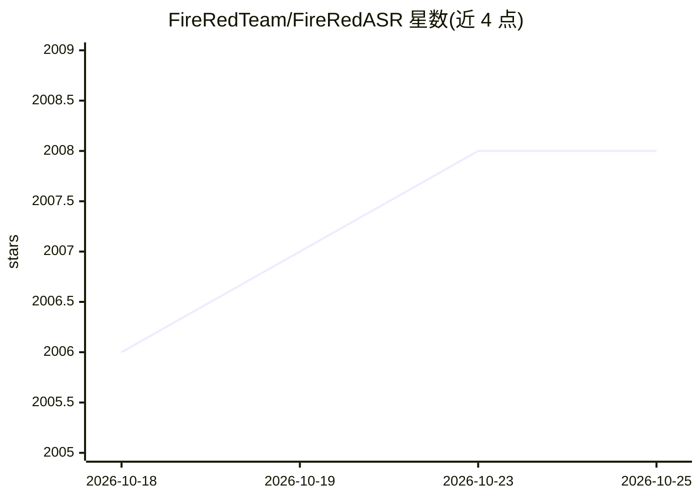

# FireRedTeam/FireRedASR

⭐ 2,008 · Python · Apache-2.0 · 推送 2026-02-25 · [GitHub](https://github.com/FireRedTeam/FireRedASR) · 组织维护 · 中文 README

**开源工业级中英及方言语音识别模型（AED 与 LLM 两版本）**

FireRedASR 提供两个开源 ASR 模型变体：FireRedASR-LLM（8.3B，Encoder-Adapter-LLM 框架，需另下载 Qwen2-7B-Instruct）与 FireRedASR-AED（1.1B，Attention Encoder-Decoder 架构），支持普通话、中文方言与英语，另具备歌声歌词识别能力。README 给出公开基准上的 CER/WER 数据；提供命令行 speech2text.py 与 Python API 两种调用方式。输入限制：AED 最长 60 秒，LLM 最长 30 秒；音频需先转为 16kHz 16-bit PCM。团队已发布后继系统 FireRedASR2S（另一仓库）。

## 筛选速览

| 维度 | 判定 | 备注 |
|---|---|---|
| AI 角色 | `ai-native` | 本体是模型或模型工具 |
| 许可风险 | `permissive` | Apache-2.0 |
| 部署形态 | `library` | 以包/库形式分发 |
| 模型依赖 | — | README 未给出锁定关系 |
| 硬件要求 | — | 无带数字的原话,不猜 |
| 安装摩擦 | `medium` | 含编译或系统依赖之一 |
| 成熟度 | — | 结构信号不足 |

## 能力要点

- FireRedASR-LLM（8.3B，Encoder-Adapter-LLM）与 FireRedASR-AED（1.1B，AED 架构）两个变体
- 支持普通话、中文方言与英语，含歌声歌词识别
- 提供命令行与 Python API 推理接口
- README 列出 aishell1/aishell2/WenetSpeech 等公开基准的 CER/WER 结果

## 适用场景

- 我在做中文语音转写，需要一个可本地部署的 ASR 模型
- 我想比较各开源 ASR 模型在普通话基准上的错误率
- 我需要把方言或英语音频转成文本

## 场景标签

`语音识别` · 领域:感知与多模态

## 证据(README 行号)

> L14: FireRedASR is a family of open-source industrial-grade automatic speech recognition (ASR) models supporting Mandari
> L25: - FireRedASR-LLM: Designed to achieve state-of-the-art (SOTA) performance and to enable seamless end-to-end speech 

## 星数曲线

2026-10-18 2,006 → 2026-10-25 2,008（+2）

---
*卡片 v1 · prompt 1.4 · 生成 2026-10-21 · 置信度 mid · 依据 README sha `64335b511ba2` · [字段定义](../../DATASET.md)*
