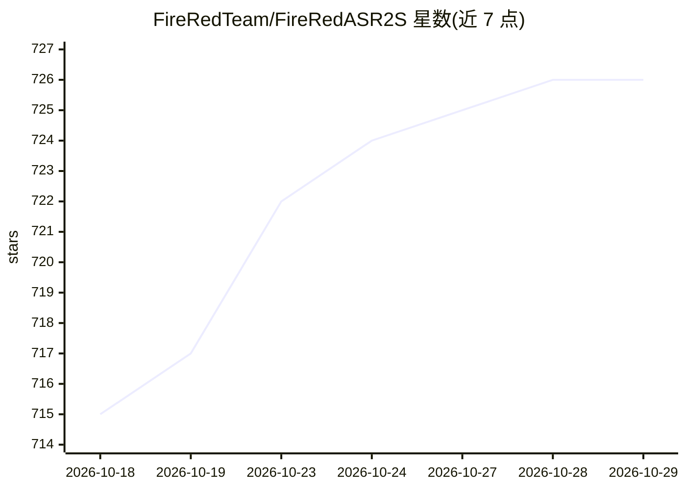

# FireRedTeam/FireRedASR2S

⭐ 726 · Python · Apache-2.0 · 推送 2026-06-02 · [GitHub](https://github.com/FireRedTeam/FireRedASR2S) · 组织维护 · 中文 README

**一体化工业级语音识别系统：ASR/VAD/LID/标点四模块**

FireRedTeam 开源的一体式 ASR 系统及模型权重，含四个可独立使用的模块：FireRedASR2（中英文及 20+ 中文方言口音、中英混说、语音与唱歌转写，提供 LLM 与 AED 两种架构变体，AED 支持词级时间戳与置信度）、FireRedVAD（100+ 语言的语音/歌声/音乐活动检测，支持流式与多标签）、FireRedLID（100+ 语言及 20+ 方言的口语语言识别）、FireRedPunc（中英文标点预测）。提供命令行 CLI、Python API 与推理脚本，FireRedASR2-LLM 可经 vLLM 部署，AED 有 TensorRT-LLM 加速支持。输入音频需为 16kHz 16-bit 单声道 PCM。

## 筛选速览

| 维度 | 判定 | 备注 |
|---|---|---|
| AI 角色 | `ai-native` | 本体是模型或模型工具 |
| 许可风险 | `permissive` | Apache-2.0 |
| 部署形态 | `library` | 以包/库形式分发 |
| 模型依赖 | local-ok | 支持本地模型 |
| 硬件要求 | — | 无带数字的原话,不猜 |
| 安装摩擦 | `medium` | 含编译或系统依赖之一 |
| 成熟度 | — | 结构信号不足 |

## 能力要点

- 四个模块（ASR/VAD/LID/Punc）均可独立使用
- 支持中文普通话、20+ 方言口音、中英混说与唱歌转写
- FireRedASR2-AED 提供词级时间戳与置信度
- FireRedASR2-LLM 可通过 vLLM 部署，另有 TensorRT-LLM 加速路径

## 适用场景

- 对含方言与口音的中文音频做语音转文字
- 构建含 VAD 切分、语种识别与标点恢复的完整转写流水线
- 为 LLM 语音应用提供带时间戳的语音表征模块

## 场景标签

`语音识别` · 领域:感知与多模态

## 证据(README 行号)

> L10: FireRedASR2S is a state-of-the-art (SOTA), industrial-grade, all-in-one ASR system with ASR, VAD, LID, and Punc mod
> L11: - **FireRedASR2**: Automatic Speech Recognition (ASR) supporting speech and singing transcription for Chinese (Mand
> L131: FireRedASR2 builds upon FireRedASR with improved accuracy, designed to meet diverse requirements in superior perfo

## 星数曲线

2026-10-18 715 → 2026-10-29 726（+11）

---
*卡片 v1 · prompt 1.4 · 生成 2026-10-22 · 置信度 mid · 依据 README sha `b09eaa04ec1c` · [字段定义](../../DATASET.md)*
