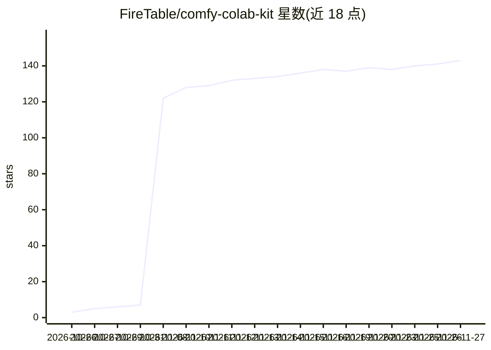

# FireTable/comfy-colab-kit

⭐ 143 · Python · MIT · 推送 2026-11-26 · [GitHub](https://github.com/FireTable/comfy-colab-kit) · [官网](https://comfy-colab-kit.firetable.tech) · 组织维护 · 中文 README

**在 Colab 临时 GPU 上按需唤醒运行 ComfyUI 的零空闲网关**

由 Python/aiohttp 编写的网关 comfy-gate：负责 ComfyUI 在 Google Colab 临时 VM 上的生命周期管理——按需唤醒（10 状态机、SSE 进度）、反向代理完整 ComfyUI Web 应用、空闲/时长/CU 预算自动关停。支持多种预置工作流 profile（MOSS-Image、FLUX.2 Klein、Wan 2.2、SD3.5、Qwen 等），可本地运行或部署在 VPS 后接 Cloudflare Access 零信任认证。对 AI agent 提供 REST/MCP 接口与 ckit CLI，可无浏览器完成唤醒、生图、生视频与释放。README 注明为个人用途工具，共享算力可能违反 Colab 条款。

## 筛选速览

| 维度 | 判定 | 备注 |
|---|---|---|
| AI 角色 | `ai-ecosystem` | LLM/agent 周边工具 |
| 许可风险 | `permissive` | MIT |
| 部署形态 | `self-host` | docker 或自建部署 |
| 模型依赖 | — | README 未给出锁定关系 |
| 硬件要求 | `gpu-24g` | |
| 安装摩擦 | `low` | 无编译、无系统依赖或容器化 |
| 成熟度 | — | 结构信号不足 |

## 能力要点

- 生命周期网关：按需唤醒、透明反代 ComfyUI、空闲/预算自动关停
- MCP 原生：stdio + HTTP 双通道，暴露 gate_status/wake/txt2img/img2img/generate/stop 工具
- 多 profile 预置（MOSS-Image、Wan 2.2、SD3.5、Qwen 等），模型经公共 URL 获取
- Cloudflare Access 零信任：Google/GitHub OAuth、Email OTP、服务令牌

## 适用场景

- 在手机或终端上一键唤醒 Colab GPU 跑 ComfyUI 生图
- 让 Claude Code/Cursor 等 agent 通过 MCP 自动出图出视频
- 小团队共享同一个 ComfyUI 会话并控制 CU 预算

## 场景标签

`图像生成` · 领域:内容生成

## 证据(README 行号)

> L29: > **The Gate's Essential Role**: `comfy-gate` is fundamentally a **lifecycle, cold-start, and auto-shutdown gateway
> L88: |**Automation & MCP**|Inaccessible to headless AI coding agents|**AI Agent & MCP Native**: Full Model Context Proto
> L95: - **Model Context Protocol (MCP) Native** — Full MCP JSON-RPC 2.0 support via local stdio (`ckit mcp`) and remote H

## 星数曲线

2026-10-26 3 → 2026-11-27 143（+140）

---
*卡片 v1 · prompt 1.4 · 生成 2026-11-27 · 置信度 mid · 依据 README sha `6e43e5905680` · [字段定义](../../DATASET.md)*
