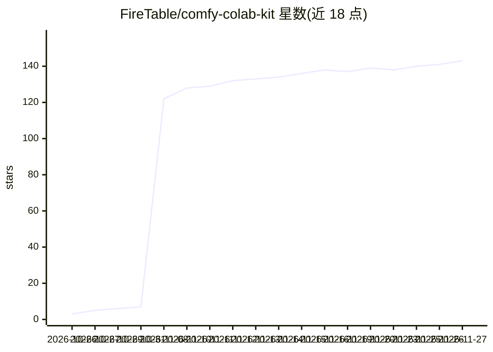

# FireTable/comfy-colab-kit

⭐ 143 · Python · MIT · 推送 2026-11-26 · [GitHub](https://github.com/FireTable/comfy-colab-kit) · [官网](https://comfy-colab-kit.firetable.tech) · 个人维护 · 中文 README

**在临时 Colab GPU 上按需唤醒/托管 ComfyUI 的网关**

一个用 Python/aiohttp 编写的轻量网关 comfy-gate，管理运行在临时 Google Colab VM 上的 ComfyUI 的生命周期：休眠时提供零计算量的唤醒卡片并经 SSE 直播启动进度，启动后透明反向代理到原生 ComfyUI Web 应用。支持 10 状态机唤醒、profile.yaml 切换模型档、空闲/最大时长/CU 预算自动关停，可本地零配置运行或部署于 VPS + Cloudflare Access 零信任架构。提供 REST 与 MCP（stdio/HTTP）接口及 ckit CLI，供 Claude Code、Cursor 等自主 agent 无浏览器调用；README 注明为个人用途工具，与他人共享 Colab 算力可能违反条款。

## 筛选速览

| 维度 | 判定 | 备注 |
|---|---|---|
| AI 角色 | `ai-ecosystem` | LLM/agent 周边工具 |
| 许可风险 | `permissive` | MIT |
| 部署形态 | `self-host` | docker 或自建部署 |
| 模型依赖 | — | README 未给出锁定关系 |
| 硬件要求 | — | 无带数字的原话,不猜 |
| 安装摩擦 | `low` | 无编译、无系统依赖或容器化 |
| 成熟度 | — | 结构信号不足 |

## 能力要点

- 10 状态机冷启动网关，SSE 实时进度，透明反向代理原生 ComfyUI（含 WebSocket）
- profile.yaml 切换 MOSS-Image / FLUX.2 Klein / Wan 2.2 Video / SD3.5 / Qwen 档案
- 完整 MCP 支持（stdio + HTTP），暴露 gate_status/gate_wake/gate_txt2img/gate_stop 等工具
- 空闲/CU 预算/静默时段自动关停，可本地零 VPS 或 VPS + Cloudflare 零信任部署

## 适用场景

- 在手机或终端远程唤醒休眠中的 Colab ComfyUI 并直接使用
- 让 Claude Code/Cursor 等自主 agent 通过 MCP/REST 调用文生图、图生图与视频生成
- 团队以自定义域名 + Cloudflare Access 共享同一 ComfyUI 会话并控制 CU 预算

## 场景标签

`图像生成` `视频生成` · 领域:内容生成

## 证据(README 行号)

> L26: A tiny gateway, **comfy-gate** (Python / aiohttp), runs either **100% locally on your Mac/PC (zero VPS, zero domain
> L29: > **The Gate's Essential Role**: `comfy-gate` is fundamentally a **lifecycle, cold-start, and auto-shutdown gateway
> L95: - **Model Context Protocol (MCP) Native** — Full MCP JSON-RPC 2.0 support via local stdio (`ckit mcp`) and remote H

## 星数曲线

2026-10-26 3 → 2026-11-27 143（+140）

---
*卡片 v1 · prompt 1.4 · 生成 2026-11-17 · 置信度 mid · 依据 README sha `a232470a1b91` · [字段定义](../../DATASET.md)*
