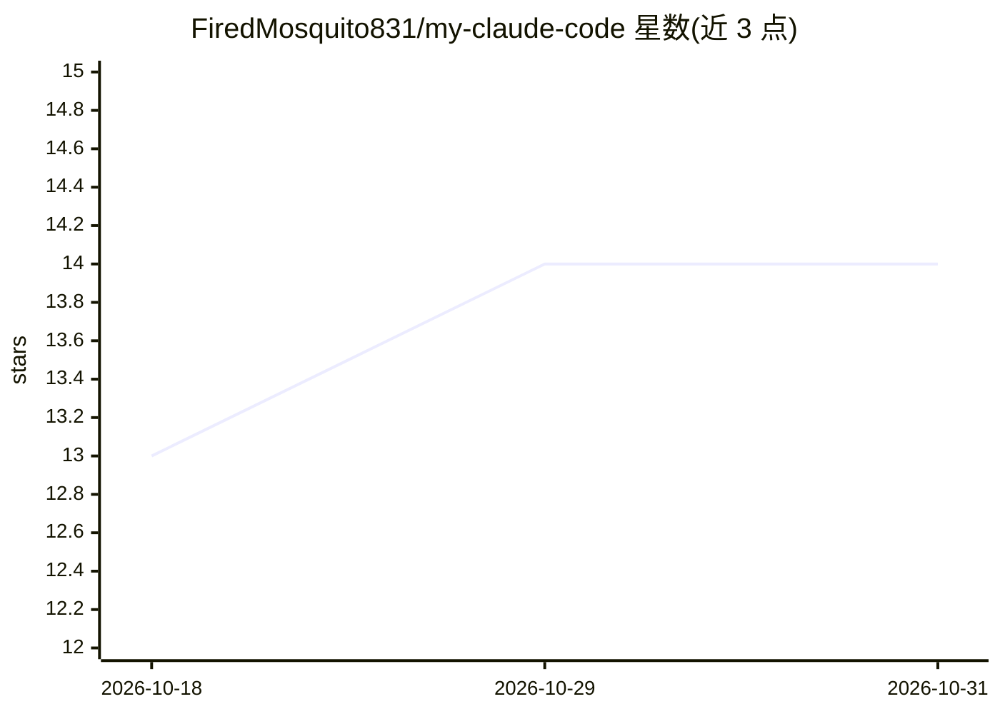

# FiredMosquito831/my-claude-code

⭐ 14 · Python · NOASSERTION · 推送 2026-10-30 · [GitHub](https://github.com/FiredMosquito831/my-claude-code) · [官网](https://firedmosquito831.github.io/my-claude-code/) · 个人维护

**面向 AI 编程代理的本地多提供商 LLM 代理与模型路由网关**

MCC 是运行在用户本机的 LLM 网关、代理与模型路由器：让 Claude Code、Codex、OpenCode、Gemini CLI 等多个编程代理指向同一地址，统一管理路由分层、回退链、凭证轮换与健康检查、推理控制、视觉适配、网页搜索工具代理及成本溯源与请求日志，覆盖 57 个模型提供商。提供桌面应用（Windows/macOS/Linux）与服务器安装（一键脚本、npm、PyPI），需 Python 3.14（安装脚本可自动配置）。无遥测，密钥保存在本地 .env。

## 筛选速览

| 维度 | 判定 | 备注 |
|---|---|---|
| AI 角色 | `ai-ecosystem` | LLM/agent 周边工具 |
| 许可风险 | `none` | NOASSERTION |
| 部署形态 | `desktop` | 安装包/桌面程序 |
| 模型依赖 | local-ok | 支持本地模型 |
| 硬件要求 | — | 无带数字的原话,不猜 |
| 安装摩擦 | `low` | 无编译、无系统依赖或容器化 |
| 成熟度 | — | 结构信号不足 |

## 能力要点

- 单一本地地址统一代理 20+ 编程代理客户端，覆盖 57 个模型提供商
- 路由分层、回退链、凭证轮换与健康检查
- 带成本溯源的完整请求日志与分析面板
- 提供 Windows/macOS/Linux 桌面应用及 npm/PyPI/一键脚本多种安装途径

## 适用场景

- 在多个编程代理间共享一套模型、凭证与回退链配置
- 将 Claude Code / Codex 流量路由到云端、订阅或本地模型
- 在本机统一追踪各代理的调用成本与请求日志

## 场景标签

`模型网关` `LLM 可观测性` · 领域:Agent 开发

## 证据(README 行号)

> L5: **A local multi-provider LLM proxy, model router and control plane for AI coding agents.** Claude Code, Codex, OpenC
> L92: **MCC is a local LLM gateway, proxy and model router for AI coding agents.** Instead of configuring providers, API 

## 星数曲线

2026-10-18 13 → 2026-10-31 14（+1）

---
*卡片 v1 · prompt 1.4 · 生成 2026-10-31 · 置信度 high · 依据 README sha `6db35db64922` · [字段定义](../../DATASET.md)*
