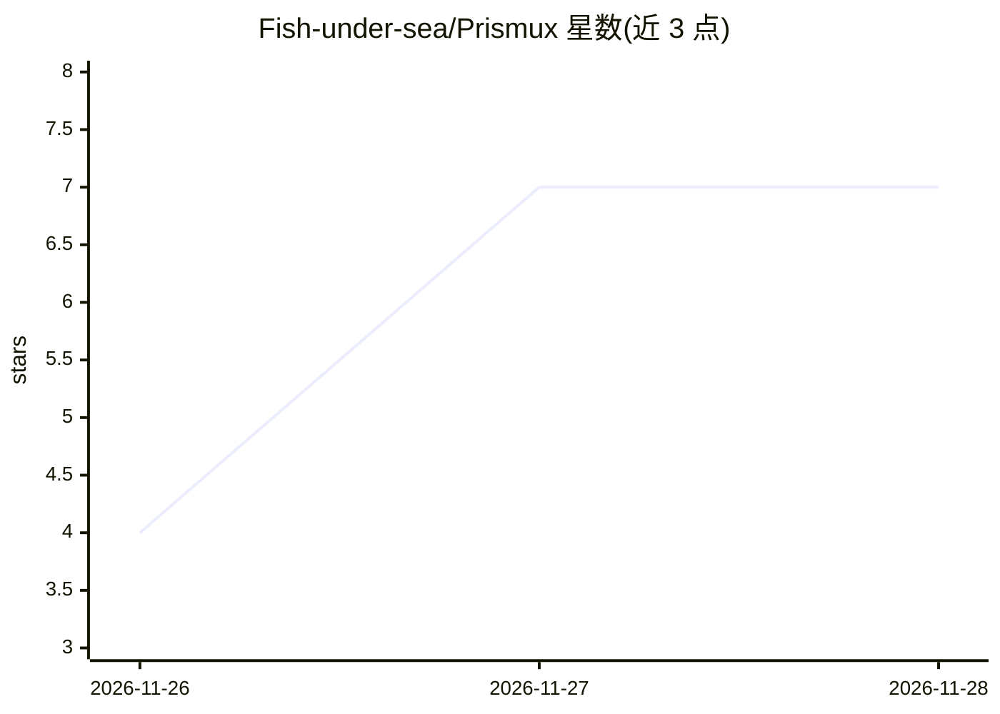

# Fish-under-sea/Prismux

⭐ 7 · TypeScript · MIT · 推送 2026-11-27 · [GitHub](https://github.com/Fish-under-sea/Prismux) · [官网](https://github.com/Fish-under-sea/Prismux#readme) · 个人维护 · 中文 README

**给多 Agent 用户的纯本地桌面工作台，统一管理多家 Coding Agent**

基于 Electron 44 + TypeScript + React 19 的 Windows 桌面应用，将 Claude Code、Codex、Antigravity、DeepSeek Harness (dsh)、OpenCode 等多家 Coding Agent 的会话收束到一个窗口内并行运行。提供单文件 SQLite（WAL + FTS5 + sqlite-vec）本地记忆、Orca 树状侧边栏与任意分屏、24 小时守护进程、局域网/Tailscale 二维码远控、Cordis 双域插件内核与 GitHub/Gitee 双源自动更新。默认零遥测，数据留驻本机；仅提供 Windows x64 安装包，macOS/Linux 通道预留未发布。

## 筛选速览

| 维度 | 判定 | 备注 |
|---|---|---|
| AI 角色 | `ai-ecosystem` | LLM/agent 周边工具 |
| 许可风险 | `permissive` | MIT |
| 部署形态 | `desktop` | 安装包/桌面程序 |
| 模型依赖 | locked-api |  |
| 硬件要求 | — | 无带数字的原话,不猜 |
| 安装摩擦 | `low` | 无编译、无系统依赖或容器化 |
| 成熟度 | `idea` | |

## 能力要点

- 统一托管 Claude Code、Codex、Antigravity、dsh、OpenCode 多家 Agent 会话
- 单文件 SQLite 本地记忆库（WAL + FTS5 + sqlite-vec），传输层物理隔离群聊作用域
- 2×2 递归任意分屏、8 分区液态玻璃主题与 Steam/多源壁纸引擎
- 官方插件默认零预装，按需独立分发并支持零残留卸载

## 适用场景

- 同时使用多家 Coding Agent 并希望在一个桌面窗口统一管理会话
- 在本地留存 Agent 长期记忆且要求零遥测、不绑定云端账号
- 通过手机扫码在局域网内远控桌面上的 Agent 工作台
- 为 Prismux 编写或让 Agent 自动生成符合规范的插件

## 场景标签

`编码 Agent` · 领域:编码与开发

## 证据(README 行号)

> L19:  Prismux · 纯本地零遥测的 8 分区液态玻璃 AI 超级工作台与 24 小时常驻秘书
> L36: - **多 Agent 统一驾驭、Windows 原生 `dsh` 实连与订阅风控护栏**：Claude Code、Codex、Antigravity（官方 `agy acp` + 事件驱动按需额度刷新）、原生实机直连的 **`D
> L81:  Electron 44 桌面端托管 24 小时守护进程 <code>@prismux/daemon</code>，支持 Claude Code、Codex、Antigravity（官方 <code>agy acp</code> 

## 星数曲线

2026-11-26 4 → 2026-11-28 7（+3）

---
*卡片 v1 · prompt 1.4 · 生成 2026-11-26 · 置信度 mid · 依据 README sha `15bbdb80ed5d` · [字段定义](../../DATASET.md)*
