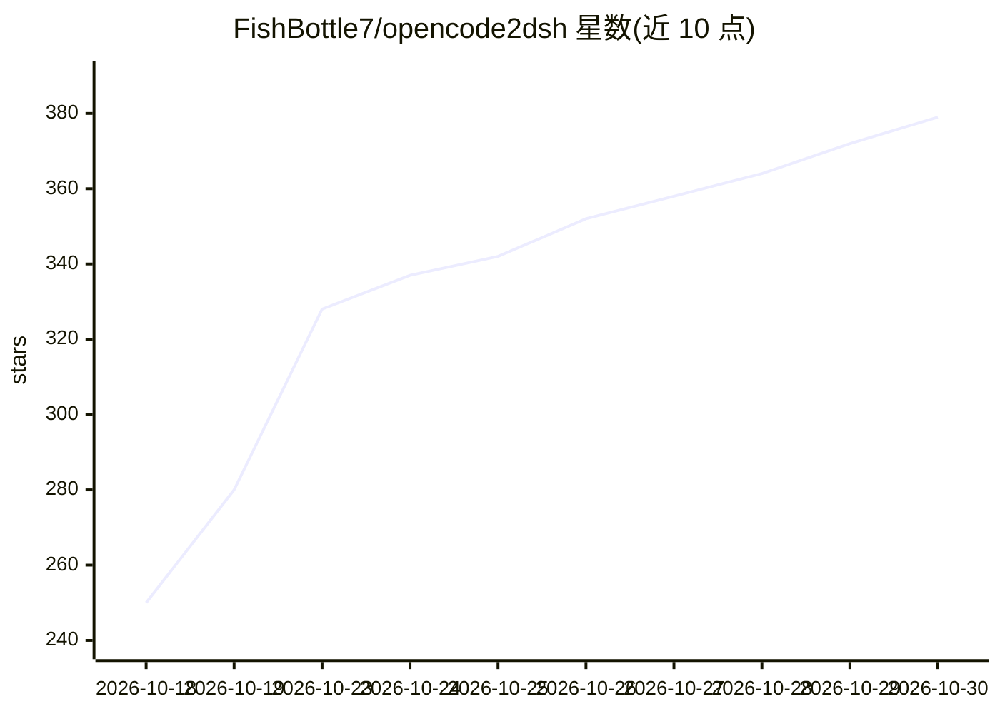

# FishBottle7/opencode2dsh

⭐ 379 · TypeScript · MIT · 推送 2026-10-20 · [GitHub](https://github.com/FishBottle7/opencode2dsh) · [官网](https://www.npmjs.com/package/@opencode2dsh/dsh-plugin) · 个人维护 · 中文 README

**DSH 插件：将 OpenCode Zen 免费模型接入 DeepSeek Harness**

面向 DeepSeek Harness (DSH) 用户的 npm 插件，注册原生 LlmAdapter，以名为 opencode2dsh 的 provider 形式将 OpenCode Zen 匿名免费通道的模型接入 DSH 模型选择器，无需 API key 或注册。请求携带 OpenCode CLI 的 user agent 与会话头，目录经 live/models.dev/静态列表三级回退链保持更新；支持推理力度选择、按声明的图像输入、模型白名单、流活性看护与 429 重试。需 DSH ≥0.1.7、Node.js ≥20 及到 opencode.ai/models.dev 的出站 HTTPS；存在区域限制与配额限制，遗留 Go sidecar 需自行构建。

## 筛选速览

| 维度 | 判定 | 备注 |
|---|---|---|
| AI 角色 | `ai-ecosystem` | LLM/agent 周边工具 |
| 许可风险 | `permissive` | MIT |
| 部署形态 | `library` | 以包/库形式分发 |
| 模型依赖 | — | README 未给出锁定关系 |
| 硬件要求 | — | 无带数字的原话,不猜 |
| 安装摩擦 | `low` | 无编译、无系统依赖或容器化 |
| 成熟度 | — | 结构信号不足 |

## 能力要点

- 原生 LlmAdapter 直连 OpenCode Zen 匿名免费通道，无需 API key
- live/models.dev/静态列表三级目录回选链与磁盘缓存
- 推理力度选择、按声明支持图像输入、模型白名单
- 健康快照与分类错误处理（429 重试、403 凭据门可选本地委托）

## 适用场景

- 在 DSH 中免 key 使用 OpenCode Zen 免费模型对话
- 为 DSH 增加 OpenCode CLI 同源的模型 provider
- 通过模型白名单限定可用模型范围

## 场景标签

`模型网关` · 领域:Agent 开发

## 证据(README 行号)

> L14: opencode2dsh registers a native DSH `LlmAdapter` that streams directly from
> L27: - **Native adapter, no sidecar** — one npm package, no child process, no binary, no local port (the legacy Go sidec

## 星数曲线

2026-10-18 250 → 2026-10-30 379（+129）

---
*卡片 v1 · prompt 1.4 · 生成 2026-10-22 · 置信度 high · 依据 README sha `3c827a50cb9e` · [字段定义](../../DATASET.md)*
