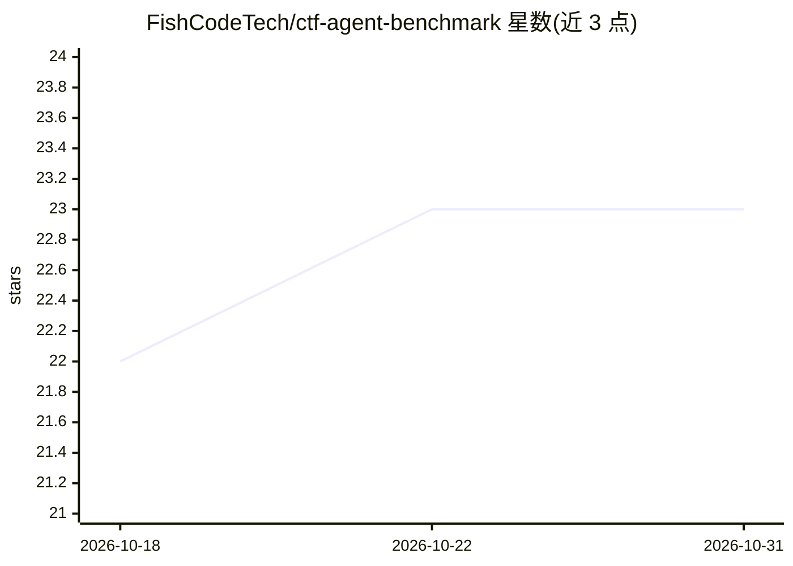

# FishCodeTech/ctf-agent-benchmark

⭐ 23 · Python · GPL-3.0 · 推送 2026-03-14 · [GitHub](https://github.com/FishCodeTech/ctf-agent-benchmark) · 组织维护 · 中文 README

**评估 LLM Agent 在 CTF 安全挑战中攻防能力的竞赛平台**

基于 Web 的 LLM Agent 安全基准测试平台：通过 MCP（Model Context Protocol）协议为 Agent 提供标准化工具接口，Agent 可自主获取题目、启动 Docker 靶机环境、执行攻击并提交 Flag，实现端到端自动化安全评估。技术栈为 React 18 前端 + FastAPI 异步后端 + PostgreSQL/Redis，Agent 模板基于 LangChain 与 langchain-mcp-adapters。支持 Docker Compose 一键部署生产模式，配置通过环境变量管理（含 OpenAI API 密钥与模型名称）。GPL-3.0 开源。

## 筛选速览

| 维度 | 判定 | 备注 |
|---|---|---|
| AI 角色 | `ai-ecosystem` | LLM/agent 周边工具 |
| 许可风险 | `viral` | GPL-3.0 |
| 部署形态 | `self-host` | docker 或自建部署 |
| 模型依赖 | — | README 未给出锁定关系 |
| 硬件要求 | — | 无带数字的原话,不猜 |
| 安装摩擦 | `low` | 无编译、无系统依赖或容器化 |
| 成熟度 | — | 结构信号不足 |

## 能力要点

- MCP 协议提供标准化工具接口，Agent 自主获取题目、启动靶机、提交 Flag
- React 18 + FastAPI + PostgreSQL/Redis 全栈架构
- Docker Compose 一键部署生产模式，另有开发模式配置

## 适用场景

- 组织 CTF 式的 LLM Agent 安全攻防竞赛
- 评估不同 Agent 在自动化安全任务中的表现
- 团队注册并部署 Agent 镜像参与基准测试

## 场景标签

`模型评测` `网络安全` · 领域:评测与运维

## 证据(README 行号)

> L3: LLM Agent 安全基准测试平台 —— 一个用于评估大语言模型 Agent 在 CTF（Capture The Flag）安全挑战中自主攻防能力的竞赛平台。
> L5: 平台通过 MCP（Model Context Protocol）协议为 Agent 提供标准化的工具接口，Agent 可自主获取题目、启动靶机环境、执行攻击并提交 Flag，实现端到端的自动化安全评估。

## 星数曲线

2026-10-18 22 → 2026-10-31 23（+1）

---
*卡片 v1 · prompt 1.4 · 生成 2026-10-27 · 置信度 high · 依据 README sha `4910845ca166` · [字段定义](../../DATASET.md)*
