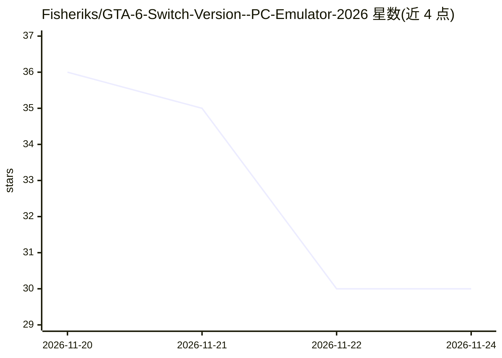

# Fisheriks/GTA-6-Switch-Version--PC-Emulator-2026

⭐ 18 · Rust · Apache-2.0 · 推送 2026-11-21 · [GitHub](https://github.com/Fisheriks/GTA-6-Switch-Version--PC-Emulator-2026) · 个人维护

**面向 Windows 用户的 GTA VI PC 版安装与优化指南站点**

一个面向 Windows 10/11 用户的 GTA VI PC 版安装准备与配置指南仓库，内容覆盖 Windows 系统检查、显卡驱动更新、存储与兼容性检查、图形设置与 FPS 排障条目，以及 Rockstar Games Launcher 准备步骤。README 明确声明 PC 版尚未公布发布日期与官方配置，且配套安装器不含 GTA VI 游戏文件，游戏须通过授权渠道另行获取。附官方资源链接与 SEO 关键词列表。

## 筛选速览

| 维度 | 判定 | 备注 |
|---|---|---|
| AI 角色 | `ai-knowledge` | 知识聚合/清单类 |
| 许可风险 | `permissive` | Apache-2.0 |
| 部署形态 | `desktop` | 安装包/桌面程序 |
| 模型依赖 | — | README 未给出锁定关系 |
| 硬件要求 | — | 无带数字的原话,不猜 |
| 安装摩擦 | `low` | 无编译、无系统依赖或容器化 |
| 成熟度 | `idea` | |

## 能力要点

- Windows 准备流程：系统更新、DirectX/Driver 检查、存储核查
- 通用 PC 图形设置与 FPS/卡顿/显示问题排障清单
- 系统配置表目前全部标注 Not confirmed，待官方发布后更新

## 适用场景

- 为未来 GTA VI PC 版提前准备 Windows 环境与驱动
- 参考通用 PC 游戏画质与 FPS 排障条目
- 查阅 GTA VI PC 版发布信息的官方链接入口

## 场景标签

 · 领域:游戏/桌面工具

## 证据(README 行号)

> L5: A dedicated PC installation and configuration resource for Grand Theft Auto VI, covering Windows preparation, graphi
> L49: The companion installer does not contain or install GTA VI game files.
> L238: No. The project installer is intended for a separate Windows setup companion. GTA VI must be acquired through an a

## 星数曲线

2026-11-20 36 → 2026-11-24 30（-6）

---
*卡片 v1 · prompt 1.4 · 生成 2026-11-22 · 置信度 mid · 依据 README sha `2fe487426686` · [字段定义](../../DATASET.md)*
