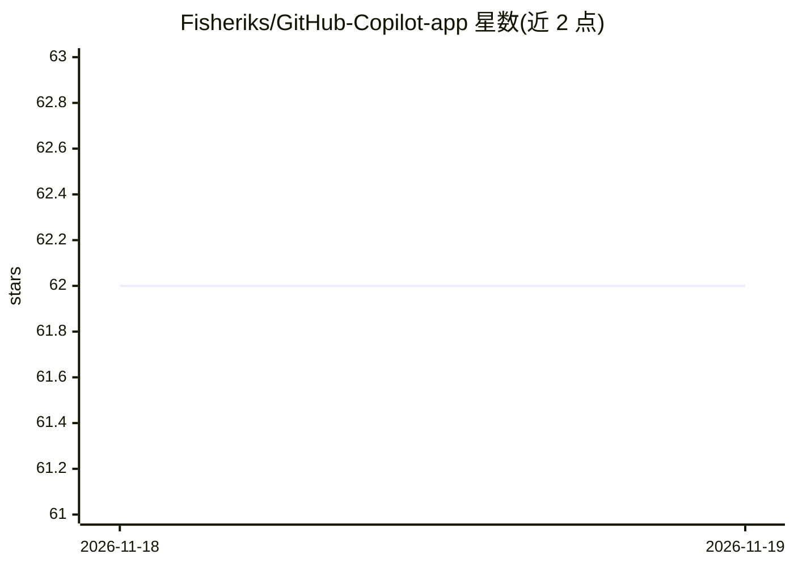

# Fisheriks/GitHub-Copilot-app

⭐ 62 · Apache-2.0 · 推送 2026-11-18 · [GitHub](https://github.com/Fisheriks/GitHub-Copilot-app) · 组织维护

**开发者管理跨仓库 agent 开发工作的桌面控制中心**

GitHub 官方的桌面应用，定位为 agent 原生的开发工作管理界面：从发现任务、启动与引导 agent、审查进度到合入变更，覆盖从想法到 pull request 的流程。每个本地会话运行在独立的 git worktree 中，云会话使用 GitHub 托管的隔离环境。提供 Canvases 展示 agent 的计划、终端、diff 与工作流状态，My Work 汇总会话/issue/PR，Automations 将提示词转为定时任务，Agent Merge 跟进 PR 审查与合并条件。需要 Git 与任一 GitHub Copilot 计划，或通过 BYOK 使用自己的模型提供商；应用从 Releases 页下载。

## 筛选速览

| 维度 | 判定 | 备注 |
|---|---|---|
| AI 角色 | `ai-ecosystem` | LLM/agent 周边工具 |
| 许可风险 | `permissive` | Apache-2.0 |
| 部署形态 | `desktop` | 安装包/桌面程序 |
| 模型依赖 | — | README 未给出锁定关系 |
| 硬件要求 | — | 无带数字的原话,不猜 |
| 安装摩擦 | `low` | 无编译、无系统依赖或容器化 |
| 成熟度 | — | 结构信号不足 |

## 能力要点

- 本地会话使用隔离 git worktree，云会话使用 GitHub 托管隔离环境
- Canvases 提供可查看、可编辑重定向的 agent 工作界面
- Automations 将可重复提示词转为定时/后台任务
- 支持 BYOK（自带密钥）使用自己的模型提供商

## 适用场景

- 并行驱动多个 agent 处理 bug 修复、issue 实现与审查反馈
- 在不切换终端、编辑器与浏览器页签的情况下管理跨仓库开发工作
- 将重复性工作流配置为定时或后台自动化任务

## 场景标签

`编码 Agent` · 领域:编码与开发

## 证据(README 行号)

> L13: The GitHub Copilot app is an agent-native desktop experience for managing software work from idea to pull request. 
> L15: The app is built for parallel agent-driven development. Each local session runs in its own isolated git worktree, a
> L26: - A GitHub Copilot plan — any plan works, including Copilot Free and GitHub Copilot Student. No Copilot plan? You c

## 星数曲线

2026-11-18 62 → 2026-11-19 62（+0）

---
*卡片 v1 · prompt 1.4 · 生成 2026-11-19 · 置信度 high · 依据 README sha `db7fa9f8df45` · [字段定义](../../DATASET.md)*
