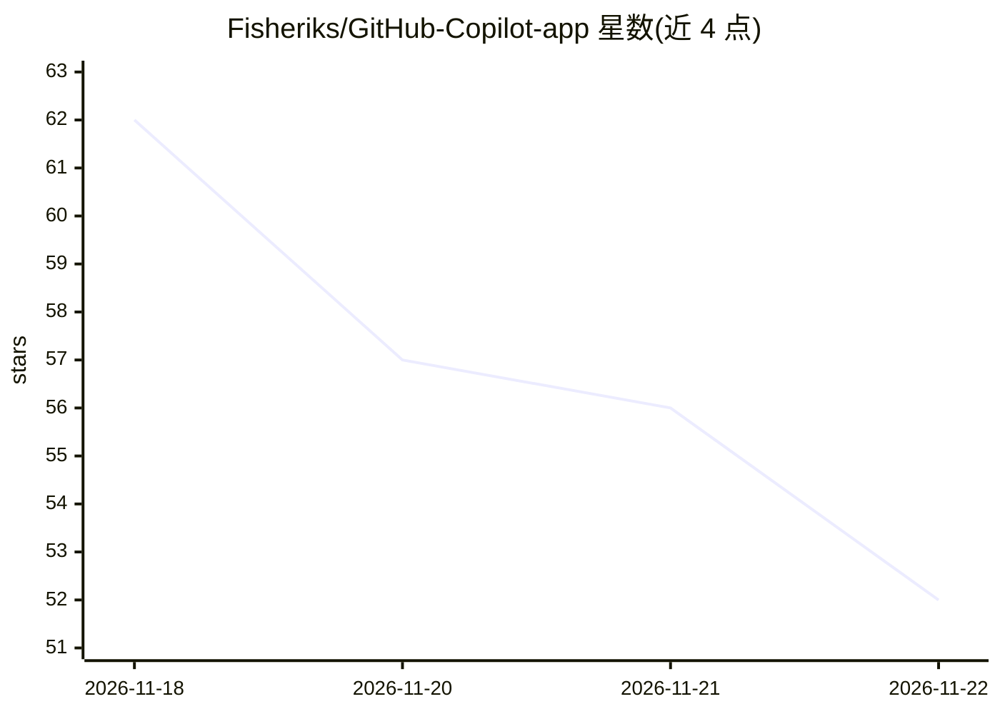

# Fisheriks/GitHub-Copilot-app

⭐ 52 · Apache-2.0 · 推送 2026-11-21 · [GitHub](https://github.com/Fisheriks/GitHub-Copilot-app) · 组织维护

**GitHub 仓库软件工作的 agent 桌面控制中心**

面向开发者的桌面应用，用于从想法到 pull request 全流程管理跨仓库的软件工作：挑选任务、启动与引导 agent、查看进度并合入变更。每个本地会话运行在独立 git worktree，云端会话使用 GitHub 托管的隔离环境；Canvases 将计划、终端、diff、工作流状态呈现为可查看的共享界面；My Work 聚合会话、issue 与 PR，Automations 支持定时/后台任务，Agent Merge 协助推进 PR 通过审查与合并条件。需 Git 与 Copilot 订阅（含免费档）或 BYOK 自带模型密钥。

## 筛选速览

| 维度 | 判定 | 备注 |
|---|---|---|
| AI 角色 | `ai-ecosystem` | LLM/agent 周边工具 |
| 许可风险 | `permissive` | Apache-2.0 |
| 部署形态 | `desktop` | 安装包/桌面程序 |
| 模型依赖 | — | README 未给出锁定关系 |
| 硬件要求 | — | 无带数字的原话,不猜 |
| 安装摩擦 | `low` | 无编译、无系统依赖或容器化 |
| 成熟度 | — | 结构信号不足 |

## 能力要点

- 本地会话独立 git worktree、云会话 GitHub 托管隔离环境，支持并行 agent 开发
- Canvases 提供计划/终端/diff/工作流状态的可查看共享界面
- Automations 将重复提示词转为定时或后台任务
- 无 Copilot 订阅时可通过 BYOK 自带模型密钥使用

## 适用场景

- 在统一界面同时启动并引导多个 agent 处理 bug、issue 与审查反馈
- 跨仓库挑选任务、跟踪会话/issue/PR 并推进合并
- 将重复性提示词工作流设为定时后台任务

## 场景标签

`编码 Agent` · 领域:编码与开发

## 证据(README 行号)

> L13: The GitHub Copilot app is an agent-native desktop experience for managing software work from idea to pull request. 
> L15: The app is built for parallel agent-driven development. Each local session runs in its own isolated git worktree, a

## 星数曲线

2026-11-18 62 → 2026-11-22 52（-10）

---
*卡片 v1 · prompt 1.4 · 生成 2026-11-20 · 置信度 high · 依据 README sha `73923405c57f` · [字段定义](../../DATASET.md)*
