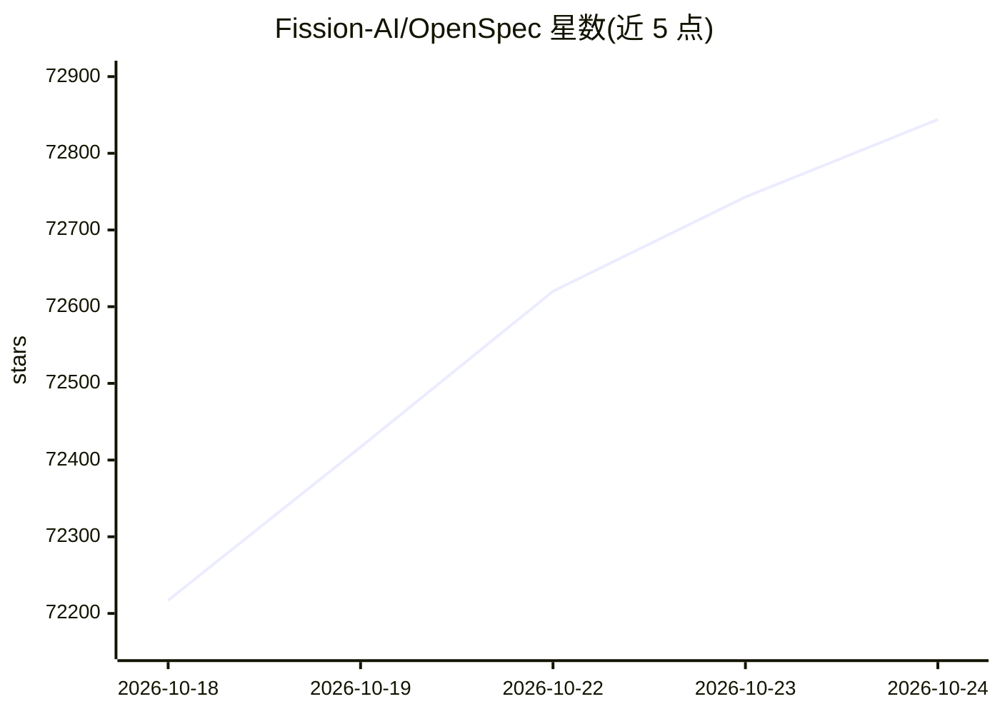

# Fission-AI/OpenSpec

⭐ 72,844 · TypeScript · MIT · 推送 2026-10-23 · [GitHub](https://github.com/Fission-AI/OpenSpec) · [官网](https://openspec.dev/) · 组织维护

**为 AI 编码助手提供规范化规格开发（SDD）工作流的 CLI 工具**

OpenSpec 以 CLI 形式在项目中建立 specs/changes 目录结构，让人与 AI 助手在写代码前先对齐规格：AI 按斜杠命令（/opsx:explore、/opsx:propose 等）读取代码并生成 Markdown 格式的需求与场景，由人审核后再进入实现。每个变更独立成目录，包含提案、规格、设计与任务。支持 30+ AI 编码工具，通过 openspec init 生成对应命令形式；提供 beta 阶段的 Stores 机制支持跨仓库团队共享规格。需 Node.js 20.19.0+，经 npm 或 Homebrew 安装。

## 筛选速览

| 维度 | 判定 | 备注 |
|---|---|---|
| AI 角色 | `ai-native` | 本体是模型或模型工具 |
| 许可风险 | `permissive` | MIT |
| 部署形态 | `library` | 以包/库形式分发 |
| 模型依赖 | — | README 未给出锁定关系 |
| 硬件要求 | — | 无带数字的原话,不猜 |
| 安装摩擦 | `low` | 无编译、无系统依赖或容器化 |
| 成熟度 | — | 结构信号不足 |

## 动量与使用信号

- 维护:`active` — 距上次 push 1.2 天,年发版 39,147 位贡献者
- 涨星:近 1 天 **+140**(自 20261016 起算)
- 安装:npm 包 `@fission-ai/openspec` 月下载 2,842,320
- 平台:MACOS / LINUX / WEB · 协议:—

## 能力要点

- 通过 /opsx:explore、/opsx:propose 等斜杠命令驱动 AI 生成 Markdown 规格
- 支持 30+ AI 编码工具，init 自动输出各工具的命令形式
- Stores 机制（beta）支持跨仓库、团队共享的规格存储
- openspec update 可刷新各项目内 AI 指引

## 适用场景

- 在使用 AI 编码助手前先与其对齐需求规格
- 团队跨多个代码仓库协作同一功能的规划与需求共享
- 平台团队维护规格供其他团队以只读方式消费

## 场景标签

 · 领域:软件开发流程/工程效能

## 证据(README 行号)

> L134: - **Use your tools** — works with 30+ AI assistants via slash commands
> L129: AI coding assistants are powerful but unpredictable when requirements live only in chat history. OpenSpec adds a l

## 星数曲线

2026-10-18 72,217 → 2026-10-24 72,844（+627）

---
*卡片 v1 · prompt 1.4 · 生成 2026-10-18 · 置信度 high · 依据 README sha `8063b3c124be` · [字段定义](../../DATASET.md)*
