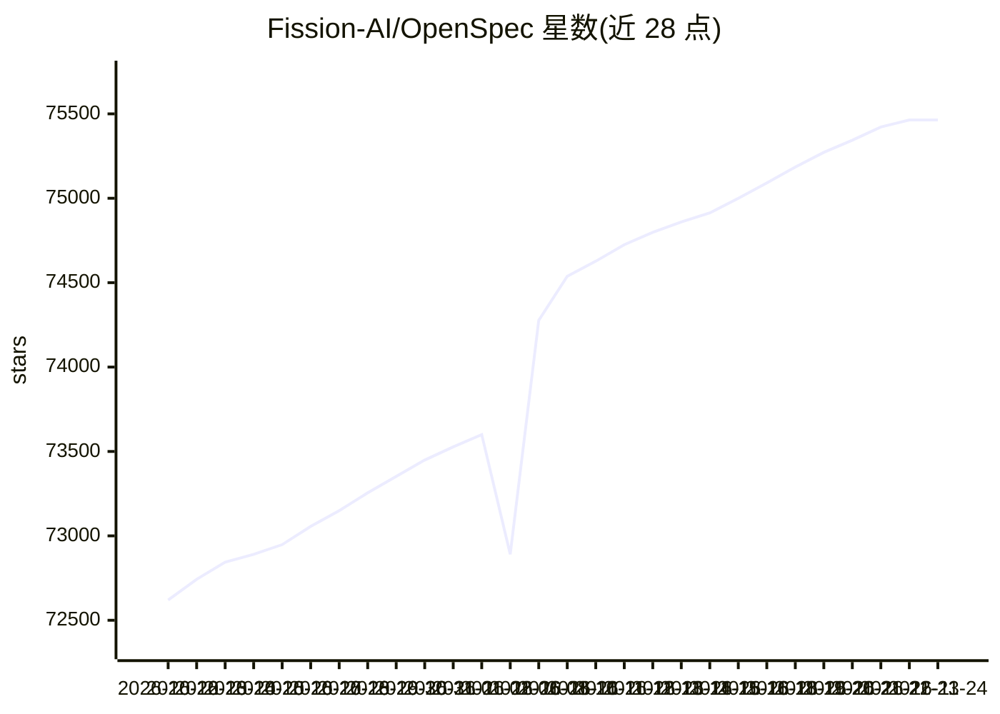

# Fission-AI/OpenSpec

⭐ 75,464 · TypeScript · MIT · 推送 2026-11-22 · [GitHub](https://github.com/Fission-AI/OpenSpec) · [官网](https://openspec.dev/) · 组织维护

**为 AI 编码助手提供规格驱动开发的 CLI 工具**

OpenSpec 是一个 CLI 工具，在 AI 编码助手中引入规格驱动开发流程：通过 `openspec init` 在项目中创建 specs/changes 目录结构，AI 依据 spec 先产出计划与需求（纯 Markdown 格式），人在写代码前审阅。提供 /openspec-explore、/openspec-propose 等 skills，支持 30+ AI 编码工具，并支持跨仓库共享需求的 Stores（beta）。通过 npm、Homebrew 或安装脚本分发，需 Node.js 22.20.0+（npm 安装时）。

## 筛选速览

| 维度 | 判定 | 备注 |
|---|---|---|
| AI 角色 | `ai-ecosystem` | LLM/agent 周边工具 |
| 许可风险 | `permissive` | MIT |
| 部署形态 | `library` | 以包/库形式分发 |
| 模型依赖 | — | README 未给出锁定关系 |
| 硬件要求 | — | 无带数字的原话,不猜 |
| 安装摩擦 | `low` | 无编译、无系统依赖或容器化 |
| 成熟度 | — | 结构信号不足 |

## 动量与使用信号

- 维护:`active` — 距上次 push 1.2 天,年发版 39,147 位贡献者
- 涨星:近 1 天 **+140**(自 20261016 起算)
- 安装:npm 包 `@fission-ai/openspec` 月下载 2,842,320
- 平台:MACOS / LINUX / WEB · 协议:—

## 能力要点

- AI 编码前先生成 spec，人类审阅计划后再写代码
- 通过 skills 机制适配 30+ AI 编码工具
- Stores 支持跨仓库共享需求（beta）
- 规格为纯 Markdown，无需学习特殊语法

## 适用场景

- 在写代码前让 AI 与团队对齐功能需求
- 跨多个仓库协调一个功能的规划
- 团队以共享 spec 仓库作为需求的单一事实来源

## 场景标签

`编码 Agent` · 领域:编码与开发

## 证据(README 行号)

> L129: AI coding assistants are powerful but unpredictable when requirements live only in chat history. OpenSpec adds a l
> L134: - **Use your tools** — works with 30+ AI assistants via skills
> L102: These are skills. Most tools invoke them as `/openspec-propose` and Codex as `$openspec-propose`, or you can ask f

## 星数曲线

2026-10-22 72,620 → 2026-11-24 75,464（+2,844）

---
*卡片 v1 · prompt 1.4 · 生成 2026-11-22 · 置信度 high · 依据 README sha `eb57c488f526` · [字段定义](../../DATASET.md)*
