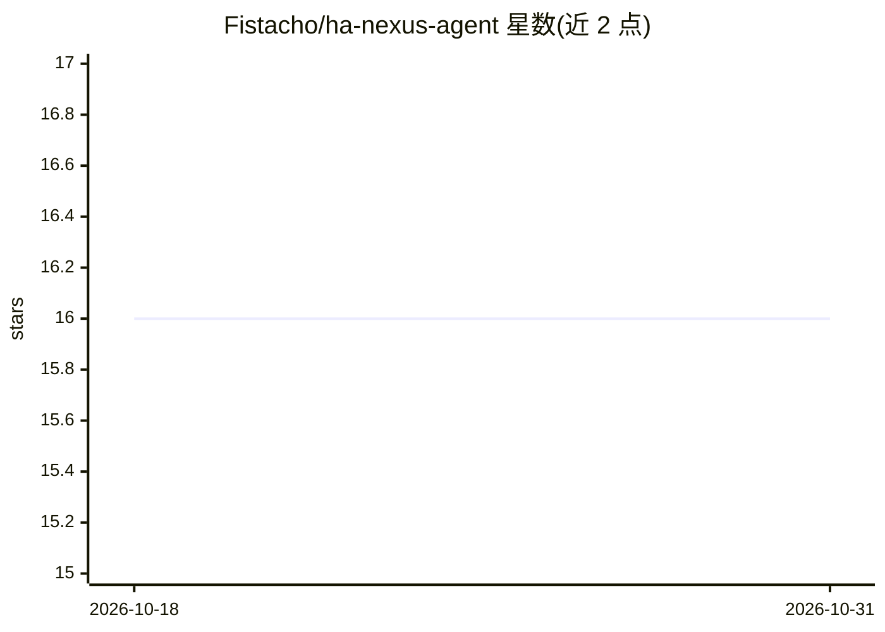

# Fistacho/ha-nexus-agent

⭐ 16 · Python · MIT · 推送 2026-10-25 · [GitHub](https://github.com/Fistacho/ha-nexus-agent) · 个人维护

**让 AI 助手通过 MCP 全面控制 Home Assistant 的工具服务器**

面向智能家居的 MCP server：将 Home Assistant 的实体、自动化、仪表盘、能源统计、HACS、Supervisor、ESPHome、AdGuard Home 等 30 个域封装为 329 个工具，供 Claude Code、Claude Desktop、Cursor、Gemini CLI 等 MCP 客户端调用；附 BM25 工具搜索、聚合快照、Card Builder 与 git 配置版本管理。提供 HA Add-on、预构建 Docker 镜像与 standalone 三种安装方式；破坏性操作设 confirm 门与 read_only 策略，armhf/armv7/i386 架构不再发布预构建镜像。

## 筛选速览

| 维度 | 判定 | 备注 |
|---|---|---|
| AI 角色 | `ai-ecosystem` | LLM/agent 周边工具 |
| 许可风险 | `permissive` | MIT |
| 部署形态 | `self-host` | docker 或自建部署 |
| 模型依赖 | — | README 未给出锁定关系 |
| 硬件要求 | — | 无带数字的原话,不猜 |
| 安装摩擦 | `low` | 无编译、无系统依赖或容器化 |
| 成熟度 | — | 结构信号不足 |

## 能力要点

- 329 个工具覆盖 30 个 Home Assistant 域（实体/自动化/仪表盘/能源/ESPHome/Supervisor 等）
- 兼容 Claude Code、Claude Desktop、Cursor、Windsurf、OpenAI Codex CLI、Gemini CLI 等 MCP 客户端
- 破坏性操作（重启/回滚/删除）需 confirm=True，支持 read_only 命名空间策略
- 提供 HA Add-on、预构建签名 Docker 镜像与 standalone 三种安装方式

## 适用场景

- 用自然语言让 AI 助手控制灯光、创建自动化、排查实体问题
- 通过 AI 客户端管理 Lovelace 仪表盘与自定义卡片
- 让 AI 编译并 OTA 刷写 ESPHome 设备、管理 LVGL 显示界面
- 把 HA 配置变更提交到 git 并生成变更摘要

## 场景标签

`工作流自动化` · 领域:效率与自动化

## 证据(README 行号)

> L9: **Give AI assistants full control over your smart home.** **329 tools across 30 domains** — entities, automations & 
> L11: Works with **Claude Code**, **Claude Desktop**, **VS Code**, **Cursor**, **Windsurf**, **OpenAI Codex CLI**, **Gemi

## 星数曲线

2026-10-18 16 → 2026-10-31 16（+0）

---
*卡片 v1 · prompt 1.4 · 生成 2026-10-30 · 置信度 high · 依据 README sha `ff91ff66e6d9` · [字段定义](../../DATASET.md)*
