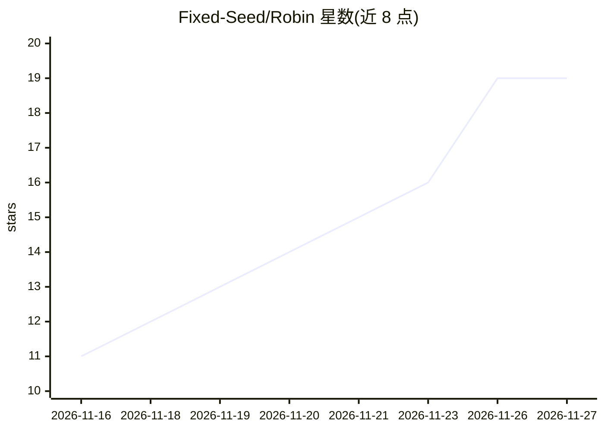

# Fixed-Seed/Robin

⭐ 19 · Python · NOASSERTION · 推送 2026-11-18 · [GitHub](https://github.com/Fixed-Seed/Robin) · [官网](https://audiorobin.io) · 组织维护

**面向专业音频工作者的开源权重语音合成模型**

Robin 是 Fixed Seed 发布的开源权重语音合成模型（3.58B 参数，planner+flow-matching decoder 架构），支持文本设计声音、对已有录音换声、以及用自制录音训练 LoRA 声音适配器。输出 48 kHz 音频，支持英语与日语混排，文本中可用 [laughs] 等内联标签控制语气。提供 Python 包（命令行、浏览器 app）、ComfyUI 节点与工作流示例，换声支持最长 45 秒录音并保留原词、时长与语气。

## 筛选速览

| 维度 | 判定 | 备注 |
|---|---|---|
| AI 角色 | `ai-native` | 本体是模型或模型工具 |
| 许可风险 | `none` | NOASSERTION |
| 部署形态 | `library` | 以包/库形式分发 |
| 模型依赖 | — | README 未给出锁定关系 |
| 硬件要求 | `gpu-8g` | |
| 安装摩擦 | `low` | 无编译、无系统依赖或容器化 |
| 成熟度 | — | 结构信号不足 |

## 能力要点

- 48 kHz 输出，英语/日语或一行内混用
- LoRA 声音训练脚本随模型发布，每个声音存为单文件
- 换声保留原录音的词、时长与语气（最长 45 秒）
- 提供 ComfyUI 节点与两个官方工作流

## 适用场景

- 用文字描述直接生成配音语音
- 把已有旁白录音换成另一个声音
- 用自己的录音训练专属 LoRA 声音模型
- 在 ComfyUI 工作流中集成语音合成节点

## 场景标签

`语音合成` `微调` · 领域:内容生成

## 证据(README 行号)

> L6: Zero-shot cloning is never good enough for studio work. That's why we trained Robin: an open-weights model built for
> L40: python -m robin speak "That went better than expected [laughs]" --model . --voice "a warm, low voice, close to the 

## 星数曲线

2026-11-16 11 → 2026-11-27 19（+8）

---
*卡片 v1 · prompt 1.4 · 生成 2026-11-18 · 置信度 high · 依据 README sha `ed2fd4f706f0` · [字段定义](../../DATASET.md)*
