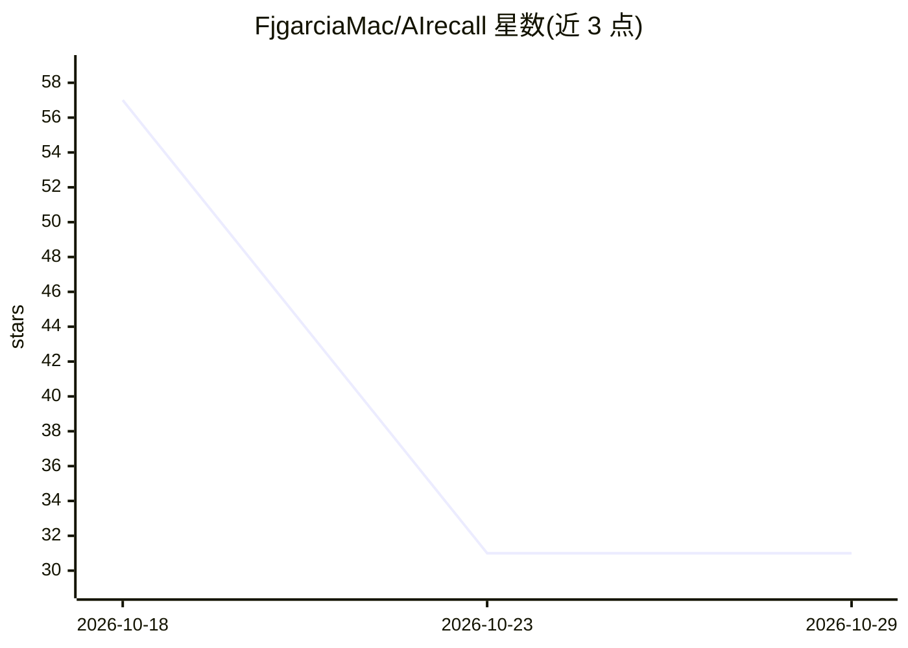

# FjgarciaMac/AIrecall

⭐ 31 · Go · MIT · 推送 2026-10-03 · [GitHub](https://github.com/FjgarciaMac/AIrecall) · 个人维护

**给 AI agent 的长期记忆层：情节+语义记忆与混合检索**

面向 AI agent 开发者的持久记忆中间层：Python SDK 嵌入 agent 代码与持久存储之间，核心为 Go 编写的记忆服务器，通过本地调用或 gRPC 通信。每轮对话时执行关键词+向量相似度的混合检索，返回 top-k 相关记忆注入提示词；后台定期将旧情节压缩为语义记忆中的持久事实。存储用 SQLite 与进程内向量索引，SDK 仅依赖标准库，服务器仅一个纯 Go 依赖，MIT 许可，并提供 LangChain 适配器。

## 筛选速览

| 维度 | 判定 | 备注 |
|---|---|---|
| AI 角色 | `ai-ecosystem` | LLM/agent 周边工具 |
| 许可风险 | `permissive` | MIT |
| 部署形态 | `library` | 以包/库形式分发 |
| 模型依赖 | — | README 未给出锁定关系 |
| 硬件要求 | — | 无带数字的原话,不猜 |
| 安装摩擦 | `low` | 无编译、无系统依赖或容器化 |
| 成熟度 | — | 结构信号不足 |

## 能力要点

- 情节记忆与语义记忆双层结构
- 关键词+向量的混合检索，返回 top-k 记忆注入提示词
- 自动摘要：旧情节被压缩为持久事实而非删除
- airecall init 一条命令初始化本地 SQLite 存储，无需独立服务

## 适用场景

- 让客服 bot 跨会话记住用户偏好与历史决策
- 为现有 agent 框架补充持久记忆而不改造架构
- 控制上下文成本：只注入当前轮相关的记忆

## 场景标签

`Agent 记忆` · 领域:Agent 开发

## 证据(README 行号)

> L3: **A drop-in long-term memory layer for AI agents.**
> L27: AIrecall sits between your agent and a persistent store, and gives it an
> L44:         |      Agent code      | -------------------------------> |     AIrecall Core     |

## 星数曲线

2026-10-18 57 → 2026-10-29 31（-26）

---
*卡片 v1 · prompt 1.4 · 生成 2026-10-26 · 置信度 high · 依据 README sha `ed8c7ff5d22a` · [字段定义](../../DATASET.md)*
