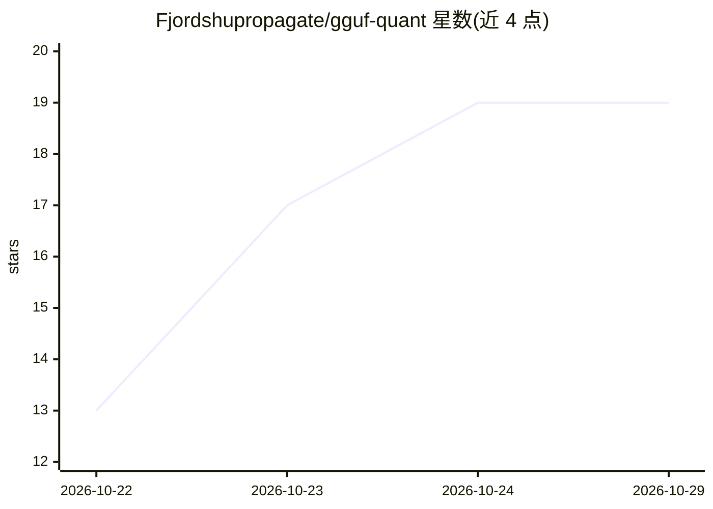

# Fjordshupropagate/gguf-quant

⭐ 19 · C# · MIT · 推送 2026-10-18 · [GitHub](https://github.com/Fjordshupropagate/gguf-quant) · 个人维护

**Windows 桌面 GUI：把 LLM 量化并转换为 GGUF 格式**

面向 Windows 10/11 x64 的量化转换 GUI 工具，封装 llama.cpp 后端：支持一键选择 Q4_K_M、Q8_0 等 K-quant 预设将 safetensors / PyTorch 检查点转换为 GGUF，内置分片合并与 Imatrix 重要性矩阵通道；提供批处理队列、每任务日志、写入前估算文件大小与所需显存，以及张量级进度条。以 100 MB 自包含单文件 exe 分发，可离线运行，无需安装；从源码构建需要 .NET 8 SDK。MIT 许可。

## 筛选速览

| 维度 | 判定 | 备注 |
|---|---|---|
| AI 角色 | `ai-ecosystem` | LLM/agent 周边工具 |
| 许可风险 | `permissive` | MIT |
| 部署形态 | `None` |  |
| 模型依赖 | local-ok | 支持本地模型 |
| 硬件要求 | — | 无带数字的原话,不猜 |
| 安装摩擦 | `medium` | 含编译或系统依赖之一 |
| 成熟度 | — | 结构信号不足 |

## 能力要点

- K-quant 预设一键量化并转换为 GGUF
- 批处理队列与逐任务日志，支持过夜批量转换
- 写入前估算文件大小与所需 VRAM
- 100 MB 自包含便携 exe，离线运行，发布附带 SHA-256 校验

## 适用场景

- 在 Windows 上不搭 Python 环境就把本地模型转成 GGUF 量化版
- 批量排队转换多个模型和多个量化档位
- 转换前预估各量化档位的体积和显存占用

## 场景标签

`模型量化` · 领域:训练与推理

## 证据(README 行号)

> L3: 📦 Free, open-source GUI to quantize and convert LLMs to GGUF on Windows — presets, batch queue, VRAM hints. 100 MB p
> L16: - ✅ **Real progress** — tensor-level progress bars from the llama.cpp backend, not a fake spinner

## 星数曲线

2026-10-22 13 → 2026-10-29 19（+6）

---
*卡片 v1 · prompt 1.4 · 生成 2026-10-29 · 置信度 high · 依据 README sha `6730c8aea6e7` · [字段定义](../../DATASET.md)*
