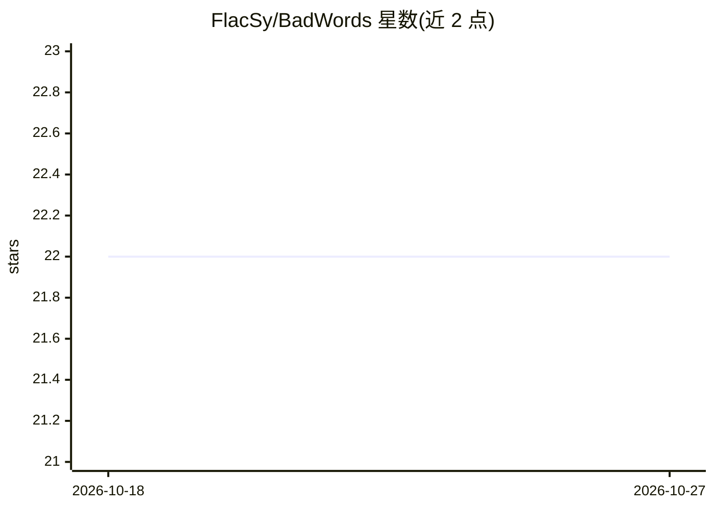

# FlacSy/BadWords

⭐ 22 · Rust · MIT · 推送 2026-10-22 · [GitHub](https://github.com/FlacSy/BadWords) · [官网](https://badwords.flacsy.dev) · 个人维护

**多语言脏话过滤库（Rust 核心，Python/JS/Rust），可选 ML 毒性评分**

面向开发者的内容审核库：先对文本做规范化（NFKC、大小写折叠、同形字符、西里尔/拉丁转写），再在覆盖 25 种语言、20330 条词目的词典中查找，支持模糊匹配、短语匹配、子串匹配及 leetspeak/重复字符等规避手段检测。核心引擎用 Rust 编写，Python 经 PyO3 绑定并在每次调用时释放 GIL，JavaScript 经 WebAssembly，Rust 项目可直接依赖 crate。可选 ML 模式通过 ONNX Runtime 运行 INT8 量化的 XLM-RoBERTa，输出七个毒性维度概率，并提供规则优先、模型其次的 HybridFilter。各检测项默认关闭以控制误报。

## 筛选速览

| 维度 | 判定 | 备注 |
|---|---|---|
| AI 角色 | `ai-native` | 本体是模型或模型工具 |
| 许可风险 | `permissive` | MIT |
| 部署形态 | `library` | 以包/库形式分发 |
| 模型依赖 | — | README 未给出锁定关系 |
| 硬件要求 | — | 无带数字的原话,不猜 |
| 安装摩擦 | `low` | 无编译、无系统依赖或容器化 |
| 成熟度 | — | 结构信号不足 |

## 能力要点

- 规范化后查词典：25 语言 20330 词条，含同形字符与混合脚本处理
- Rust 核心 + PyO3（GIL 释放）+ WebAssembly 三端绑定共享同一词表
- 可选 ONNX XLM-RoBERTa（INT8）输出七个毒性维度概率
- 逐项可开关的规避检测（leetspeak/重复折叠/子串/模糊匹配）附误报率测量表

## 适用场景

- 在用户生成内容管道中检测并打码脏话
- 对评论做多维度毒性评分（侮辱/威胁/身份攻击等）
- 对抗用 Unicode 变体、leetspeak 等手段绕过的规避行为

## 场景标签

 · 领域:NLP/内容审核

## 证据(README 行号)

> L35: `BadWords` cleans up user-generated content. Unlike plain keyword matching it normalizes text first — NFKC, case fo
> L214: The optional model is XLM-RoBERTa, INT8-quantized, run through ONNX Runtime —

## 星数曲线

2026-10-18 22 → 2026-10-27 22（+0）

---
*卡片 v1 · prompt 1.4 · 生成 2026-10-27 · 置信度 high · 依据 README sha `a9668e1ad1e4` · [字段定义](../../DATASET.md)*
