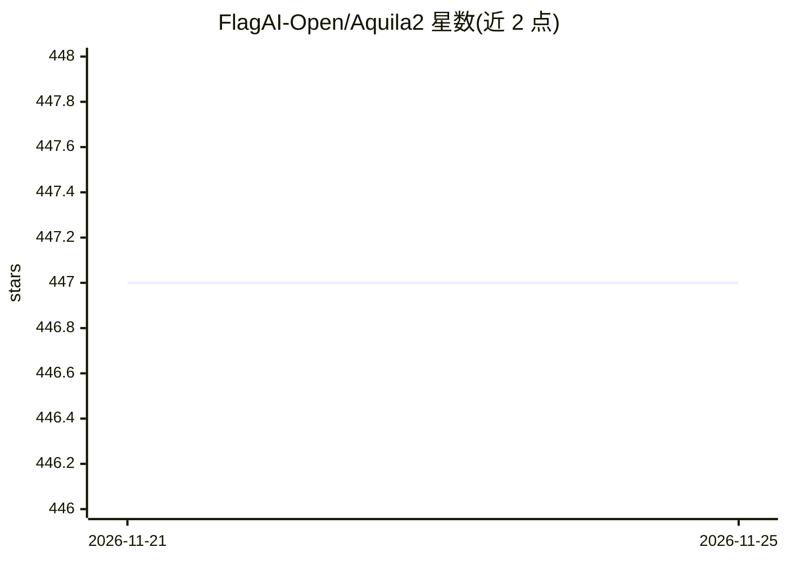

# FlagAI-Open/Aquila2

⭐ 447 · Python · 推送 2026-11-20 · [GitHub](https://github.com/FlagAI-Open/Aquila2) · 组织维护 · 中文 README

**BAAI 开源的 Aquila2 系列大语言模型仓库：预训练与对话模型下载、推理与微调**

BAAI（智源研究院）发布的 Aquila2 系列模型官方仓库，包含 7B/34B/70B-Expr 预训练模型、对应 Chat 对话模型及 16k 长文本版本。提供基于 FlagAI 与 Transformers 的推理示例、BitsAndBytes/GPTQ/AWQ 三种量化用法、全参数与 LoRA/Q-LoRA 微调脚本，预训练框架 FlagScale 基于 Megatron-LM 开源。模型权重通过 Hugging Face、ModelHub、ModelScope 等渠道分发。README 公布了评估中发现 GSM8K 测试数据泄漏的调查说明。

## 筛选速览

| 维度 | 判定 | 备注 |
|---|---|---|
| AI 角色 | `ai-native` | 本体是模型或模型工具 |
| 许可风险 | `none` | — |
| 部署形态 | `library` | 以包/库形式分发 |
| 模型依赖 | — | README 未给出锁定关系 |
| 硬件要求 | — | 无带数字的原话,不猜 |
| 安装摩擦 | `medium` | 含编译或系统依赖之一 |
| 成熟度 | `idea` | |

## 能力要点

- 提供 7B/34B/70B-Expr 预训练与对话模型及 16k 长文本版本
- 支持 BitsAndBytes、GPTQ、AWQ 三种量化推理
- 提供全参数、LoRA、Q-LoRA 微调脚本
- 预训练框架 FlagScale 基于 Megatron-LM 开源

## 适用场景

- 下载并本地运行 Aquila2/AquilaChat2 模型推理
- 用自定义对话数据微调模型适配下游任务
- 在显存受限场景使用 4-bit 量化模型

## 场景标签

`微调` `模型量化` `模型训练` · 领域:训练与推理

## 证据(README 行号)

> L5: We announce that our **Aquila2** series is now open source, comprising Aquila2 (the base language models: **Aquila2-
> L95: ## Quickstart
> L100: pip install -r requirements.txt

## 星数曲线

2026-11-21 447 → 2026-11-25 447（+0）

---
*卡片 v1 · prompt 1.4 · 生成 2026-11-21 · 置信度 high · 依据 README sha `93add6c18698` · [字段定义](../../DATASET.md)*
