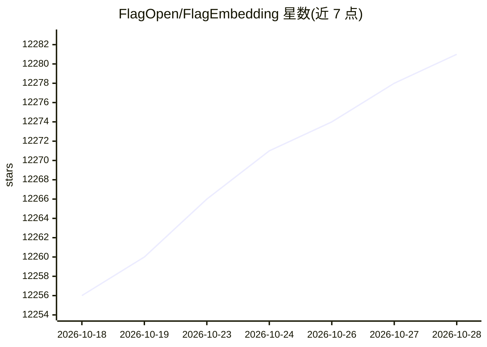

# FlagOpen/FlagEmbedding

⭐ 12,284 · Python · MIT · 推送 2026-10-27 · [GitHub](https://github.com/FlagOpen/FlagEmbedding) · [官网](http://www.bge-model.com/) · 组织维护 · 中文 README

**面向搜索与 RAG 的嵌入/重排序模型工具箱**

由 BAAI/FlagOpen 维护的检索工具集 BGE：提供文本与多模态嵌入模型、交叉编码器重排序模型的推理与微调代码，以及评测、数据集与教程。代表模型 bge-m3 支持 100+ 语言、8192 token 输入与稠密/稀疏/多向量三种检索方式。以 Python 包形式安装，含 finetune 可选依赖；部分模型基于 gemma-2-9b 等骨干，微调需相应资源。

## 筛选速览

| 维度 | 判定 | 备注 |
|---|---|---|
| AI 角色 | `ai-native` | 本体是模型或模型工具 |
| 许可风险 | `permissive` | MIT |
| 部署形态 | `library` | 以包/库形式分发 |
| 模型依赖 | — | README 未给出锁定关系 |
| 硬件要求 | — | 无带数字的原话,不猜 |
| 安装摩擦 | `low` | 无编译、无系统依赖或容器化 |
| 成熟度 | — | 结构信号不足 |

## 能力要点

- 嵌入模型与 reranker 的推理及微调代码
- bge-m3 支持多语言、8192 token、稠密/稀疏/colbert 三种检索
- BGE-VL 多模态嵌入模型与 MegaPairs 合成数据集（MIT 许可）
- 附带评测、数据集与教程模块

## 适用场景

- 为 RAG 流水线生成文本嵌入与重排序
- 微调嵌入模型适配自有领域检索
- 构建中英或多语言语义检索/搜索系统

## 场景标签

`语义搜索` `微调` · 领域:知识与检索

## 证据(README 行号)

> L1: ⚡️BGE: One-Stop Retrieval Toolkit For Search and RAG
> L72: BGE (BAAI General Embedding) focuses on retrieval-augmented LLMs, consisting of the following projects currently:
> L76: - **Inference**: Embedder, Reranker

## 星数曲线

2026-10-18 12,256 → 2026-10-28 12,281（+25）

---
*卡片 v1 · prompt 1.4 · 生成 2026-10-20 · 置信度 high · 依据 README sha `5e67f3823b1f` · [字段定义](../../DATASET.md)*
