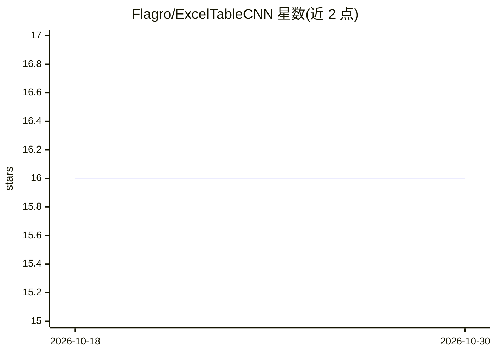

# Flagro/ExcelTableCNN

⭐ 16 · Python · MIT · 推送 2026-08-09 · [GitHub](https://github.com/Flagro/ExcelTableCNN) · 个人维护

**用视觉模型自动检测 Excel 表格边界范围的检测库**

电子表格表格检测开源库，是 TableSense 论文（AAAI 2019）的独立复现并加入自研组件。将表格每个单元格转为 30 维特征张量，经全卷积骨干网络接入 torchvision Faster R-CNN，预测每个表格的单元格范围（如 B2:H45），并用 PBR 边界对齐与网格上下文骨干提升精确边界（EoB-0）准确率。训练数据为 VEnron2 语料，预训练权重发布于 Hugging Face Hub（约 201MB）。自述处于 alpha 阶段，评测数字低于原论文。以 Python 库、控制台脚本与 notebook 提供，支持 CUDA/CPU/MPS。

## 筛选速览

| 维度 | 判定 | 备注 |
|---|---|---|
| AI 角色 | `ai-native` | 本体是模型或模型工具 |
| 许可风险 | `permissive` | MIT |
| 部署形态 | `library` | 以包/库形式分发 |
| 模型依赖 | — | README 未给出锁定关系 |
| 硬件要求 | — | 无带数字的原话,不猜 |
| 安装摩擦 | `medium` | 含编译或系统依赖之一 |
| 成熟度 | `idea` | |

## 能力要点

- 单元格 30 维特征张量化 + Faster R-CNN 预测表格范围
- 自研网格上下文骨干与 PBR 边界对齐（EoB-0 指标优化）
- 预训练权重发布于 Hugging Face Hub，免训练即可检测
- 支持 uv/pip 安装，CUDA/CPU/MPS 三种设备路径

## 适用场景

- 从大量 .xlsx/.xls 电子表格中自动定位表格范围供下游抽取
- 复现或扩展 TableSense 表格检测方法
- 在 Kaggle/Colab GPU 环境训练自己的表格检测模型

## 场景标签

`目标检测` `文档解析` · 领域:知识与检索

## 证据(README 行号)

> L3: Open-source table detection on Excel sheets with computer vision: a spreadsheet
> L16: detect_tables("report.xlsx", weights="checkpoints/final.pt")

## 星数曲线

2026-10-18 16 → 2026-10-30 16（+0）

---
*卡片 v1 · prompt 1.4 · 生成 2026-10-30 · 置信度 high · 依据 README sha `4154b22b2763` · [字段定义](../../DATASET.md)*
