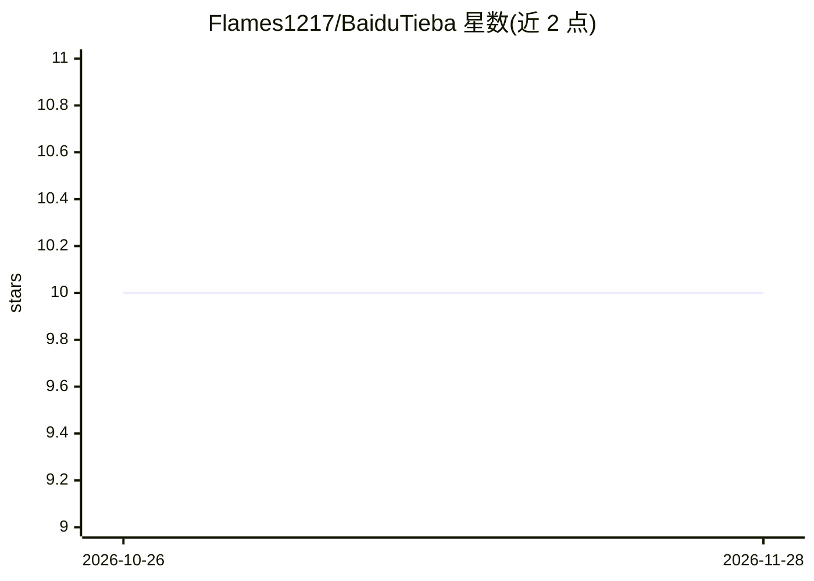

# Flames1217/BaiduTieba

⭐ 10 · Python · 推送 2026-07-24 · [GitHub](https://github.com/Flames1217/BaiduTieba) · 个人维护 · 中文 README

**爬取百度贴吧帖子并存为 CSV 的 Python 爬虫**

基于 Python 3.10 的百度贴吧爬虫：在 config.py 中设置关键词 KW、起始页数 ST 和终点页数 PN，运行 main.py 后将帖子信息写入 data/{吧名}.csv，日志记录到 logs/{吧名}.log。使用 fake_useragent 生成随机 User-Agent、多账号 cookie 构建cookie池以应对反爬，并用 rich 提供进度条显示。README 声明仅限个人学习和研究使用，未涉及任何 AI/ML 功能。

## 筛选速览

| 维度 | 判定 | 备注 |
|---|---|---|
| AI 角色 | `ai-knowledge` | 知识聚合/清单类 |
| 许可风险 | `none` | — |
| 部署形态 | `library` | 以包/库形式分发 |
| 模型依赖 | — | README 未给出锁定关系 |
| 硬件要求 | — | 无带数字的原话,不猜 |
| 安装摩擦 | `low` | 无编译、无系统依赖或容器化 |
| 成熟度 | — | 结构信号不足 |

## 能力要点

- 按关键词与页数范围爬取贴吧帖子并存为 CSV
- fake_useragent 随机 User-Agent 与多账号 cookie 池反爬
- rich 进度条可视化爬取过程，日志输出到文件

## 适用场景

- 收集指定贴吧的帖子数据用于个人学习研究
- 批量导出贴吧内容为 CSV 做后续分析

## 场景标签

`网页抓取` · 领域:效率与自动化

## 证据(README 行号)

> L3:  这是一个基于 Python 的百度贴吧爬虫，用于获取指定关键词的贴吧帖子信息并存储到 CSV 文件中。
> L22:  在 config.py 中设置需要爬取的贴吧关键词 KW、爬取起始页数 ST 和终点页数 PN。

## 星数曲线

2026-10-26 10 → 2026-11-28 10（+0）

---
*卡片 v1 · prompt 1.4 · 生成 2026-11-20 · 置信度 high · 依据 README sha `99abd22eef13` · [字段定义](../../DATASET.md)*
