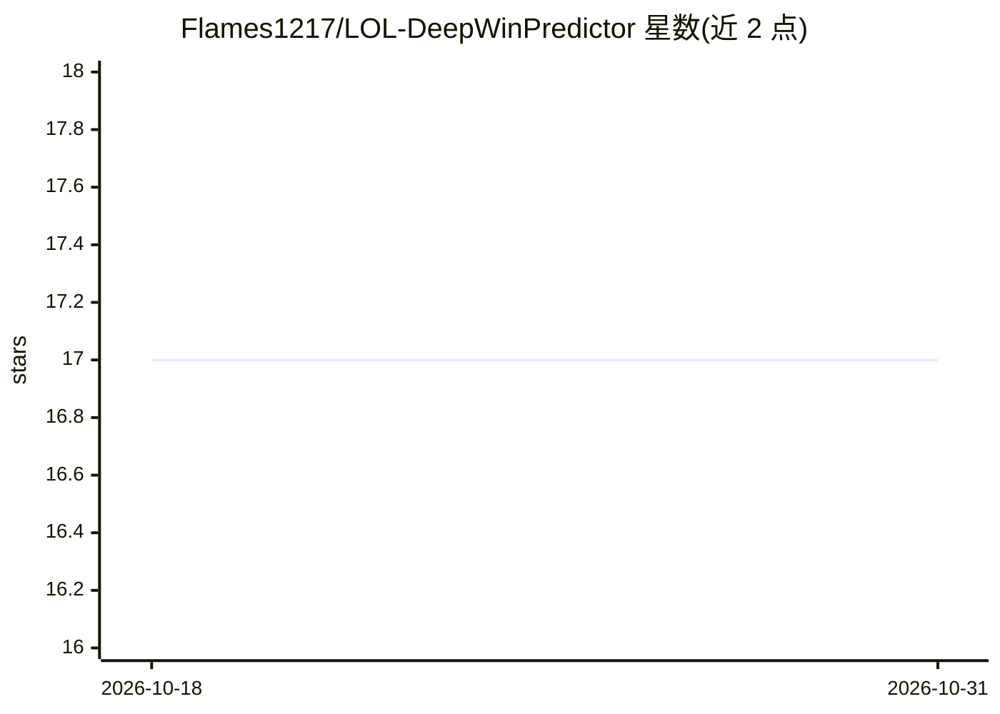

# Flames1217/LOL-DeepWinPredictor

⭐ 17 · TypeScript · 推送 2026-07-24 · [GitHub](https://github.com/Flames1217/LOL-DeepWinPredictor) · [官网](https://lol.flames.de5.net) · 个人维护 · 中文 README

**英雄联盟职业赛事数据聚合与 BiLSTM-Attention 胜率预测 Web 应用**

面向电竞数据分析的自部署 Web 应用：后端 FastAPI 抓取 OP.GG、OP.GG Esports、101.qq.com、lpl.qq.com 数据，提供英雄、战队、选手、职业赛程查询 API；本地运行 PyTorch BiLSTM-Attention 模型，输入队伍、分路、英雄、BP 等特征，输出蓝红方胜率与校准概率，并可接 OpenAI Compatible API（含 ollama）做流式 AI 解释。前端为 Next.js 静态导出。支持 full/lite/model 三种服务模式与 Hugging Face Spaces、Docker 部署；README 声明模型存在过拟合与校准不足，不做实时局内预测。

## 筛选速览

| 维度 | 判定 | 备注 |
|---|---|---|
| AI 角色 | `ai-native` | 本体是模型或模型工具 |
| 许可风险 | `none` | — |
| 部署形态 | `self-host` | docker 或自建部署 |
| 模型依赖 | local-ok | 支持本地模型 |
| 硬件要求 | — | 无带数字的原话,不猜 |
| 安装摩擦 | `low` | 无编译、无系统依赖或容器化 |
| 成熟度 | `idea` | |

## 能力要点

- BiLSTM-Attention 本地推理，输出胜率、校准概率与置信度
- 聚合 OP.GG / 101.qq.com / lpl.qq.com 四类数据源，提供 17 个查询与预测 API
- full/lite/model 三种服务模式，模型可经 MODEL_URL 远程加载或独立部署
- 可配置 OpenAI Compatible / openai / ollama 做 AI 流式分析

## 适用场景

- 赛前查看职业比赛阵容胜率预测与 AI 解释
- 查询英雄、战队、选手的职业赛事数据
- 自部署到 Hugging Face Space 或 Docker 做电竞数据展示站

## 场景标签

`数据分析` `网页抓取` · 领域:效率与自动化

## 证据(README 行号)

> L22: LOL-DeepWinPredictor 是一个英雄联盟职业赛事数据分析与胜率预测项目。它把实时数据接口、职业赛程、BP 阵容、AI 分析和本地 BiLSTM-Attention 推理整合到一个可部署的 Web 应用里。
> L279: |原始模型|BiLSTM-Attention|
> L281: |输出|蓝红方胜率、校准概率、置信度|

## 星数曲线

2026-10-18 17 → 2026-10-31 17（+0）

---
*卡片 v1 · prompt 1.4 · 生成 2026-10-30 · 置信度 high · 依据 README sha `98a6bf2c37bf` · [字段定义](../../DATASET.md)*
