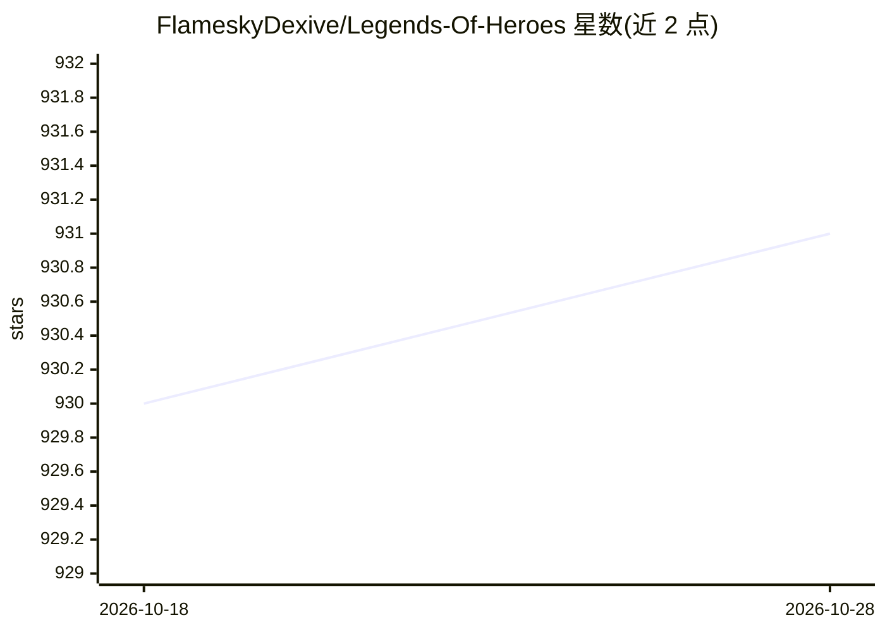

# FlameskyDexive/Legends-Of-Heroes

⭐ 931 · C# · MIT · 推送 2026-09-22 · [GitHub](https://github.com/FlameskyDexive/Legends-Of-Heroes) · 个人维护 · 中文 README

**ET 框架双端 C# 游戏框架，含战斗系统与 AI 辅助开发工具**

基于 ET 的 Unity 2022.3 + .NET 10 前后端多人游戏框架，采用状态同步架构，碰撞、技能与 AI 逻辑在服务端运行。内置 ECS 技能/Buff 系统、行为树编辑器、HybridCLR + YooAsset 热更新管线，并附带 LOL 风格球球大战 demo。AI 部分为辅助开发能力：可插拔 AI workflow hooks、AIBridge CLI 与用于编辑器自动化的 UnityMCP 桥。技能编辑器与大厅匹配仍在开发中，主要面向 Windows。

## 筛选速览

| 维度 | 判定 | 备注 |
|---|---|---|
| AI 角色 | `ai-enhanced` | 去掉 AI 部分产品仍成立 |
| 许可风险 | `permissive` | MIT |
| 部署形态 | `None` |  |
| 模型依赖 | — | README 未给出锁定关系 |
| 硬件要求 | — | 无带数字的原话,不猜 |
| 安装摩擦 | `medium` | 含编译或系统依赖之一 |
| 成熟度 | `idea` | |

## 能力要点

- 服务端权威的状态同步架构（TCP/KCP/WebSocket）
- ECS 技能/Buff 系统 + 行为树编辑器（NPC/敌人 AI）
- HybridCLR + YooAsset 代码与资源热更新管线
- UnityMCP 桥接编辑器自动化（编译/刷新/日志/预制体操作）

## 适用场景

- 开发多人在线战斗类游戏的服务端与客户端
- 复用现成技能/Buff/行为树系统搭建 MOBA 或战斗玩法
- 通过 MCP 兼容 AI agent 辅助 Unity 编辑器操作与内容制作

## 场景标签

 · 领域:游戏开发/框架

## 证据(README 行号)

> L7: This project is a front-end and back-end game framework built on the ET framework. It ships a basic hot-update pipel
> L45: - Pluggable AI workflow hooks for AI-assisted development (see `Packages/cn.etetet.harness/`).
> L72: - MCP-compatible bridge for editor automation (compile, refresh, log retrieval, prefab/scene ops).

## 星数曲线

2026-10-18 930 → 2026-10-28 931（+1）

---
*卡片 v1 · prompt 1.4 · 生成 2026-10-21 · 置信度 high · 依据 README sha `afe656f228ab` · [字段定义](../../DATASET.md)*
