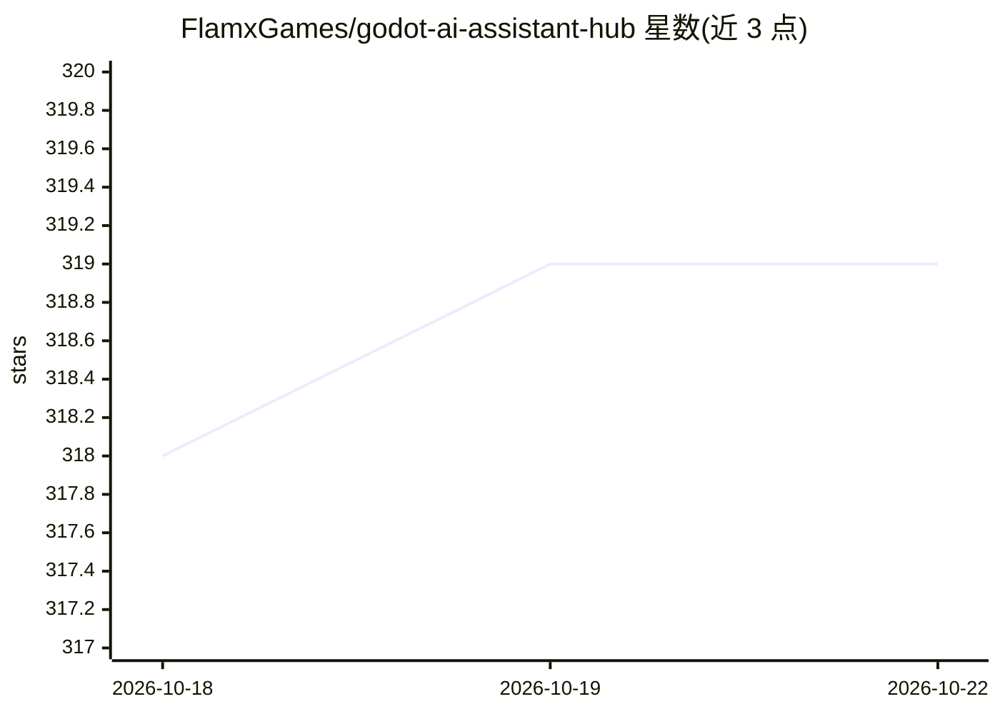

# FlamxGames/godot-ai-assistant-hub

⭐ 320 · GDScript · MIT · 推送 2026-09-01 · [GitHub](https://github.com/FlamxGames/godot-ai-assistant-hub) · 个人维护

**在 Godot 编辑器内嵌入 AI 编程助手的插件**

Godot 编辑器插件，作为 Godot 与 LLM 提供方（Ollama、llama.cpp、Gemini、Jan、OpenRouter、xAI 等）之间的接口运行，自身不直接运行模型。提供两种工作流：Tools（助手通过 28 种工具创建/编辑脚本、场景节点、资源与文件）和 Quick Prompts（基于选中代码的定点编辑，可用任意模型）。工具访问分 Allow/Ask/Hide 三级权限，支持多助手类型并行会话、对话历史编辑与远程 IP 连接。以复制 addon 文件夹方式安装，推荐 Godot 4.7。

## 筛选速览

| 维度 | 判定 | 备注 |
|---|---|---|
| AI 角色 | `ai-ecosystem` | LLM/agent 周边工具 |
| 许可风险 | `permissive` | MIT |
| 部署形态 | `None` |  |
| 模型依赖 | local-ok | 支持本地模型 |
| 硬件要求 | — | 无带数字的原话,不猜 |
| 安装摩擦 | `low` | 无编译、无系统依赖或容器化 |
| 成熟度 | — | 结构信号不足 |

## 能力要点

- Tools 工作流：28 种工具覆盖代码、场景节点、资源、文件与项目管理
- 工具权限三级控制（Allow/Ask/Hide），可按助手类型限制工具集与文件范围
- 支持 Ollama、llama.cpp、Gemini、Jan、OpenRouter、OpenWebUI、xAI 等 8 个 LLM 提供方
- Quick Prompts 用 {CODE}/{CHAT} 关键字做定点代码编辑，不要求模型支持工具

## 适用场景

- 在 Godot 内让 AI 助手创建脚本、修改场景与节点属性
- 本地跑小模型做游戏代码与场景的辅助编辑
- 按任务配置不同工具权限的专用助手类型

## 场景标签

`编码 Agent` · 领域:编码与开发

## 证据(README 行号)

> L24: This plugin does not run LLM models directly, but acts as an interface between Godot and your LLM provider. There a
> L126: This plugin was designed to be API agnostic and could be extended to support other LLM providers.

## 星数曲线

2026-10-18 318 → 2026-10-22 319（+1）

---
*卡片 v1 · prompt 1.4 · 生成 2026-10-21 · 置信度 high · 依据 README sha `16a4828c8313` · [字段定义](../../DATASET.md)*
