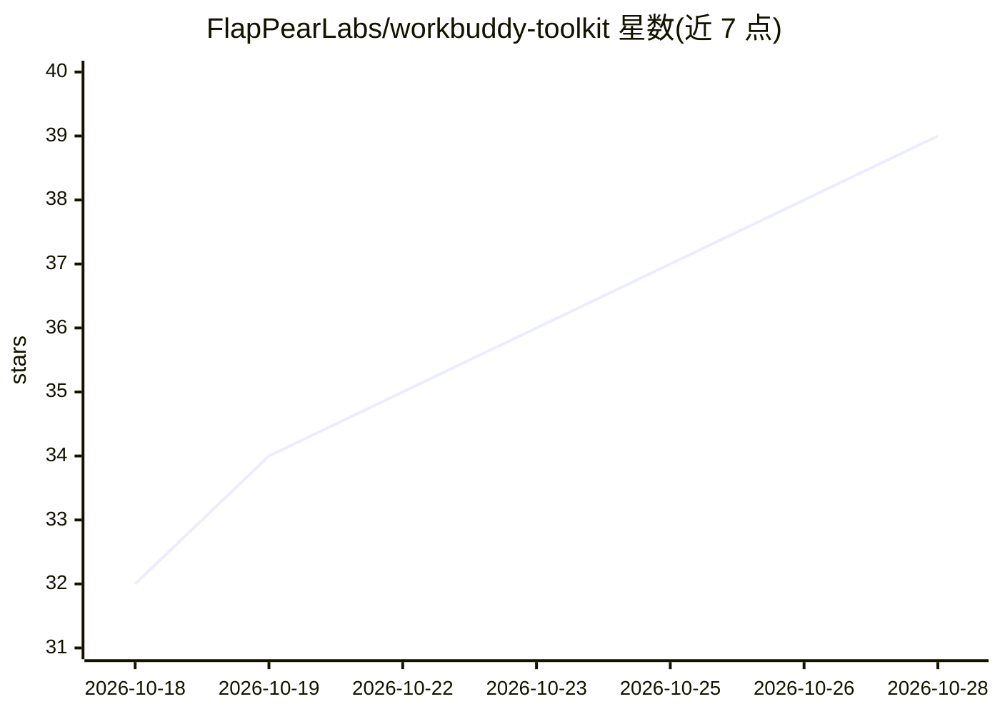

# FlapPearLabs/workbuddy-toolkit

⭐ 39 · Python · MIT · 推送 2026-10-25 · [GitHub](https://github.com/FlapPearLabs/workbuddy-toolkit) · 组织维护 · 中文 README

**WorkBuddy 多账号管理与自动签到工具集（本地旁路 CLI）**

一套针对 WorkBuddy 桌面端的本地旁路工具（sidecar），解决多账号切换、凭据生命周期（含 WorkBuddy 5.6+ 加密凭据兼容）、每日自动签到、跨账号工作区会话连续性、可选模型容灾路由与运行时稳定性问题。提供 wb-login/wb-switch/wb-checkin/wb-doctor 等 CLI 及 wb-tool 交互式终端，支持 macOS/Linux/Windows，基础安装仅用 Python 标准库。后台任务默认关闭，安装可回滚卸载。README 明示多账号自动签到可能触发平台风控或违反服务条款。

## 筛选速览

| 维度 | 判定 | 备注 |
|---|---|---|
| AI 角色 | `ai-ecosystem` | LLM/agent 周边工具 |
| 许可风险 | `permissive` | MIT |
| 部署形态 | `None` |  |
| 模型依赖 | — | README 未给出锁定关系 |
| 硬件要求 | — | 无带数字的原话,不猜 |
| 安装摩擦 | `low` | 无编译、无系统依赖或容器化 |
| 成熟度 | — | 结构信号不足 |

## 能力要点

- 多账号保存与秒级切换，切换前同步凭据避免覆盖
- wb-checkin 自动签到接入 launchd/systemd/任务计划程序等原生调度
- wb-doctor 检测上游版本漂移与兼容性
- 容灾路由仅监听 127.0.0.1 并要求每机独立 Token，凭据 0600 原子写入

## 适用场景

- 我在多个 WorkBuddy 账号间频繁切换，想保留工作区与会话连续性
- 我想让每日签到和保活任务自动运行并做健康巡检
- WorkBuddy 升级后我想先诊断兼容性再决定处理方式

## 场景标签

`模型网关` · 领域:Agent 开发

## 证据(README 行号)

> L12: WorkBuddy Toolkit 是一套本地旁路工具（sidecar），用于解决多账号切换、凭据生命周期、自动签到、跨账号工作区、模型容灾和运行时稳定性问题。
> L162: wb-chat       终端直接调用 WorkBuddy 模型
> L164: wb-router     可选模型容灾路由

## 星数曲线

2026-10-18 32 → 2026-10-28 39（+7）

---
*卡片 v1 · prompt 1.4 · 生成 2026-10-26 · 置信度 high · 依据 README sha `29d5aee0d8b1` · [字段定义](../../DATASET.md)*
