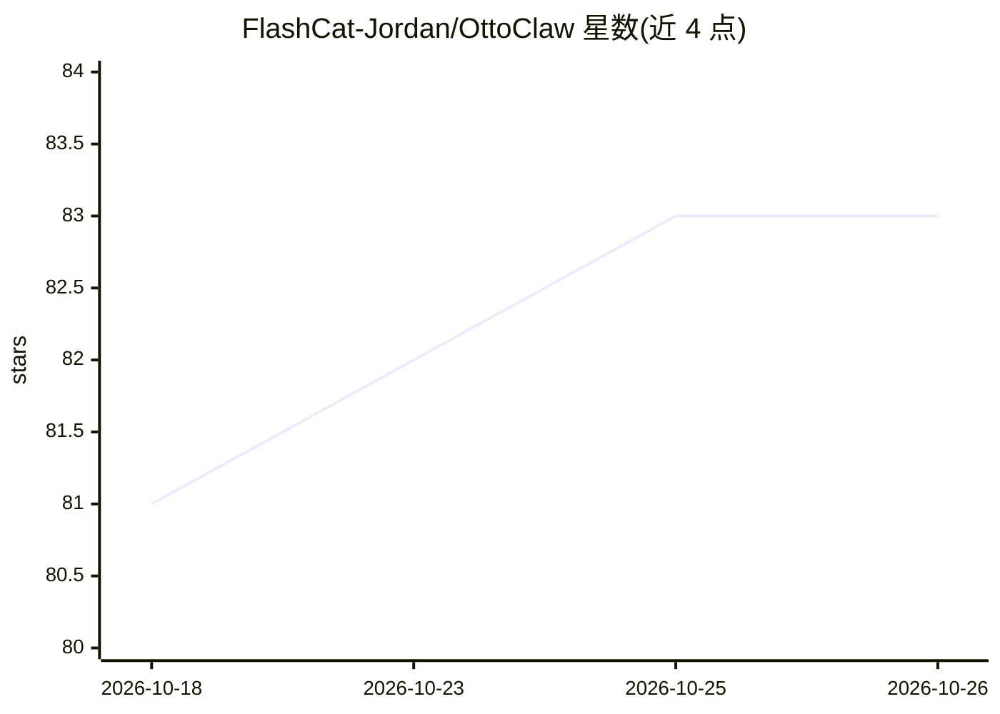

# FlashCat-Jordan/OttoClaw

⭐ 83 · C · NOASSERTION · 推送 2026-06-15 · [GitHub](https://github.com/FlashCat-Jordan/OttoClaw) · [官网](https://www.shanmaotech.cn/ottodiy) · 组织维护 · 中文 README

**ESP32-S3 端侧全栈运行的 AI 桌面人形机器人（不开口、钉钉交互）**

闪猫科技开发的 AI 桌面人形机器人系统：纯 C / FreeRTOS，单块 ESP32-S3 运行全部功能，0.5W 功耗、记忆与技能本地存储、不依赖云端。交互不通过语音，而是钉钉 Stream 消息直连，另提供 WebSocket 与串口 CLI。大模型侧支持 Anthropic 兼容与 OpenAI 兼容两种接口格式，由 AI 自主触发 22 种情绪、自主决定 6 路舵机角度生成动作，并带 5 阶段关系成长与本地纯文本记忆系统。硬件、软件、3D 模型全部开源，许可证 CC BY-NC-SA 4.0（禁止商用）。需购买开发板/DIY 套件、大模型 API Key 与钉钉账号使用。

## 筛选速览

| 维度 | 判定 | 备注 |
|---|---|---|
| AI 角色 | `ai-native` | 本体是模型或模型工具 |
| 许可风险 | `none` | NOASSERTION |
| 部署形态 | `library` | 以包/库形式分发 |
| 模型依赖 | locked-api |  |
| 硬件要求 | — | 无带数字的原话,不猜 |
| 安装摩擦 | `low` | 无编译、无系统依赖或容器化 |
| 成熟度 | — | 结构信号不足 |

## 能力要点

- 纯 C / FreeRTOS 单块 ESP32-S3 端侧运行，0.5W 24/7 在线，本地存储
- AI 自主触发 22 种情绪并自主决策 6 路舵机姿态
- 5 阶段关系成长体系与 SPIFFS 纯文本记忆（SOUL.md/MEMORY.md 等）
- 支持 Anthropic 兼容与 OpenAI 兼容接口自选模型，钉钉 Stream 直连

## 适用场景

- 桌面陪伴机器人，通过钉钉消息安静聊天与下指令
- 让 AI 用自然语言生成机器人动作与情绪表达
- 创客基于开源硬件、固件与 3D 模型二次开发

## 场景标签

`聊天机器人` `AI 助手` · 领域:对话与助手

## 证据(README 行号)

> L11: - **真正运行在本地端侧的轻量 Agent** — 纯 C / FreeRTOS，单块 ESP32-S3 即可运行全部功能，不依赖云端服务器，记忆、会话、技能全部本地存储，0.5W 功耗 24/7 在线。
> L15: - **真正的 AI 控制每一个关节** — 大模型自主决定 6 个舵机到达何种角度，创造任何它所想象的动作姿态，实现 AI 意识的物理化表达，而非依赖预设脚本。
> L383: - **Anthropic tool use / ReAct 循环** — AI 自主决定工具调用与编排

## 星数曲线

2026-10-18 81 → 2026-10-26 83（+2）

---
*卡片 v1 · prompt 1.4 · 生成 2026-10-24 · 置信度 mid · 依据 README sha `8e03641778ac` · [字段定义](../../DATASET.md)*
