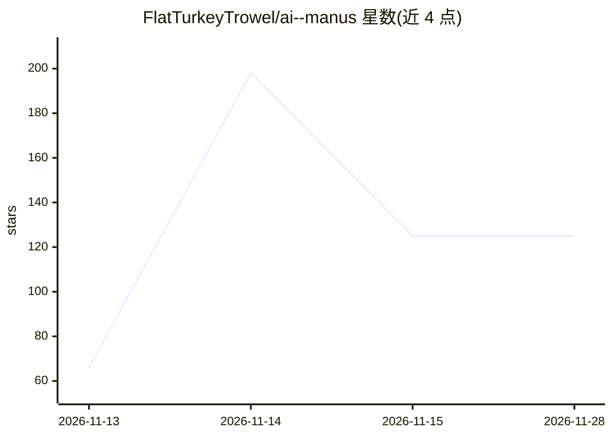

# FlatTurkeyTrowel/ai--manus

⭐ 125 · Apache-2.0 · 推送 2026-11-15 · [GitHub](https://github.com/FlatTurkeyTrowel/ai--manus) · 个人维护

**自主 AI 代理：代用户执行代码并控制浏览器完成任务**

README 介绍一个名为 Manus 的自主 AI 代理，定位为个人助手：用户描述需求后，代理自行编写并执行脚本、打开网页、填写表单、完成多步骤任务，代码执行与浏览器控制可在同一流程内衔接。面向学生、远程工作者与轻量办公场景的家庭/学习/小型任务，非企业平台。README 提供硬件兼容表（最低 4GB 内存）与使用步骤说明，但未给出任何安装命令、依赖清单或代码/许可证信息，且页面含推广码 PROMO2026，内容以营销性描述为主。

## 筛选速览

| 维度 | 判定 | 备注 |
|---|---|---|
| AI 角色 | `ai-native` | 本体是模型或模型工具 |
| 许可风险 | `permissive` | Apache-2.0 |
| 部署形态 | `None` |  |
| 模型依赖 | — | README 未给出锁定关系 |
| 硬件要求 | — | 无带数字的原话,不猜 |
| 安装摩擦 | `low` | 无编译、无系统依赖或容器化 |
| 成熟度 | — | 结构信号不足 |

## 能力要点

- 自主执行代码完成任务的代理行为
- 代理控制浏览器：导航、填表、抓取信息
- 代码执行与浏览器操作在同一工作流中衔接

## 适用场景

- 让代理代为整理研究资料、跑小脚本
- 自动浏览多个网页收集信息并汇总
- 把重复性的小型日常任务委托给后台代理

## 场景标签

`AI 助手` `浏览器自动化` `编码 Agent` · 领域:效率与自动化

## 证据(README 行号)

> L10: - **Autonomous Code Execution:** Manus AI agent runs code on its own to complete tasks, so you can focus on decisio
> L18: Manus is an autonomous AI agent designed to run code and control a browser on your behalf. Instead of acting like a

## 星数曲线

2026-11-13 66 → 2026-11-28 125（+59）

---
*卡片 v1 · prompt 1.4 · 生成 2026-11-17 · 置信度 low · 依据 README sha `0f78ee3a5dd2` · [字段定义](../../DATASET.md)*
