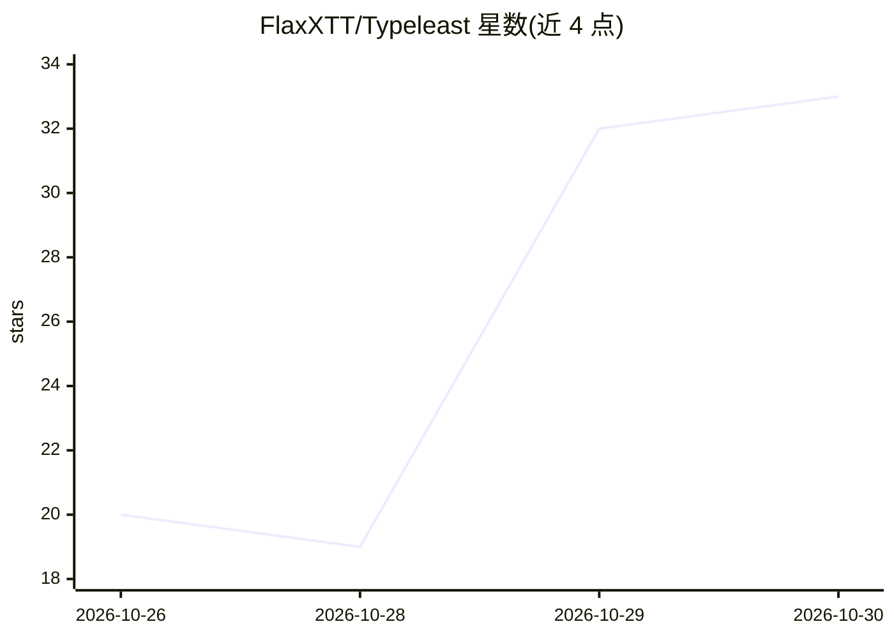

# FlaxXTT/Typeleast

⭐ 33 · Swift · GPL-3.0 · 推送 2026-10-29 · [GitHub](https://github.com/FlaxXTT/Typeleast) · [官网](https://typeleast.promptking.workers.dev) · 个人维护 · 中文 README

**桌面语音听写工具：本机识别语音，AI 整理后写入光标处**

面向 macOS 13+ 与 Windows 10/11 的免费听写软件：按快捷键说话，语音在本机识别（SenseVoice Small 等 4 个可选识别模型），识别文本再经用户自配 API Key 的 OpenAI 兼容大模型整理成通顺文字，写入任意输入框光标处。支持自然整理、AI 整理、翻译、提示词 Beta（多轮提问生成长提示词）等模式。音频不上传，Key 存系统钥匙串/凭据管理器。提供 dmg 与 exe 安装包，亦可从源码构建（Node.js 22+，Windows 侧需 .NET 8 SDK）。

## 筛选速览

| 维度 | 判定 | 备注 |
|---|---|---|
| AI 角色 | `ai-native` | 本体是模型或模型工具 |
| 许可风险 | `viral` | GPL-3.0 |
| 部署形态 | `desktop` | 安装包/桌面程序 |
| 模型依赖 | local-ok | 支持本地模型 |
| 硬件要求 | — | 无带数字的原话,不猜 |
| 安装摩擦 | `medium` | 含编译或系统依赖之一 |
| 成熟度 | `idea` | |

## 能力要点

- 本机识别，音频不上传，四个可选识别模型（SenseVoice/FireRedASR2/Fun-ASR-Nano/Qwen3-ASR）
- 使用用户自己的 OpenAI 兼容 API Key 做整理，支持 Ollama 本机完全免费
- 自然整理/AI 整理/翻译（10 种语言）/提示词 Beta 四种模式
- 词典、历史、偏好本地加密保存，插件不运行代码

## 适用场景

- 按一下快捷键说话，把整理后的文字写进任意输入框
- 用口述方式生成结构化长提示词
- 说话录入后直接翻译成其他语言

## 场景标签

`语音识别` `AI 写作` `提示工程` · 领域:Agent 开发

## 证据(README 行号)

> L11:  免费的 Mac 和 Windows 听写软件。 按一下，说话。再按一下，文字写到光标处。 语音在 你的电脑上 识别，文字由 你选的模型 整理。
> L24:  功能：自然整理；音频不出电脑；写到任何输入框；AI 整理；四个本机识别模型；你的 Key。
> L138: |**SenseVoice Small**（默认）|中、英、粤、日、韩。小而快。|0.24 GB|

## 星数曲线

2026-10-26 20 → 2026-10-30 33（+13）

---
*卡片 v1 · prompt 1.4 · 生成 2026-10-28 · 置信度 high · 依据 README sha `b8f6eb6cfc04` · [字段定义](../../DATASET.md)*
