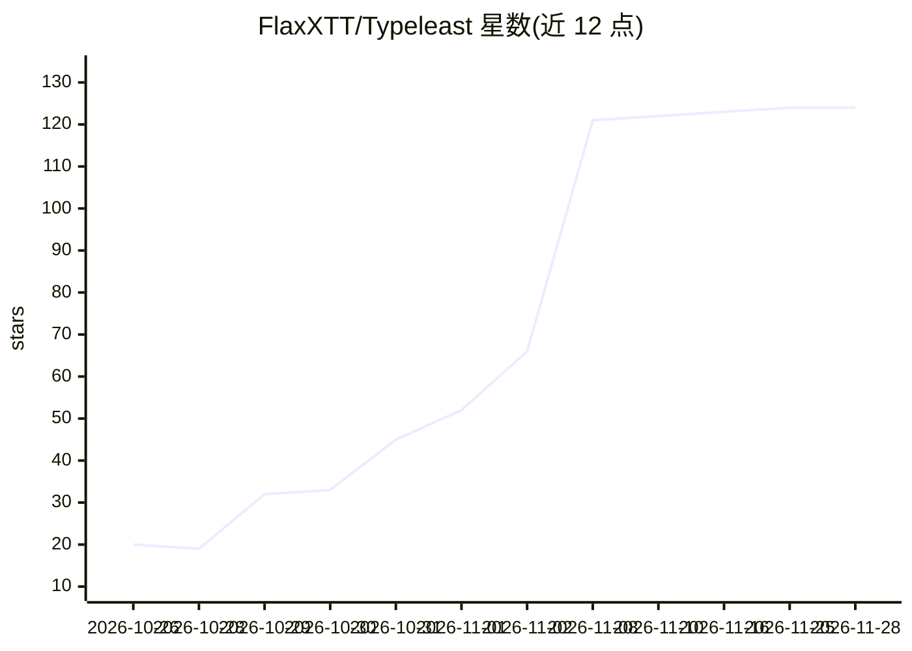

# FlaxXTT/Typeleast

⭐ 124 · Swift · GPL-3.0 · 推送 2026-11-27 · [GitHub](https://github.com/FlaxXTT/Typeleast) · [官网](https://typeleast.promptking.workers.dev) · 个人维护 · 中文 README

**桌面语音听写工具：快捷键说话，本地识别后写入光标处**

TypeLeast 是面向 macOS（Apple 芯片）与 Windows 11 的桌面听写工具：按一下 Fn 开始说话，说完再按即结束，语音经识别并由大模型整理后直接写入光标位置。语音识别可使用本地模型，也可接入用户自己的 API；提供 Fn+Shift 选中文字翻译、Fn+空格打开 Harness EQ 选择 Skill 或 MCP 后写入。附听写统计与使用热力图，GPL-3.0 许可，提供安装包与源码构建说明。

## 筛选速览

| 维度 | 判定 | 备注 |
|---|---|---|
| AI 角色 | `ai-native` | 本体是模型或模型工具 |
| 许可风险 | `viral` | GPL-3.0 |
| 部署形态 | `None` |  |
| 模型依赖 | — | README 未给出锁定关系 |
| 硬件要求 | — | 无带数字的原话,不猜 |
| 安装摩擦 | `low` | 无编译、无系统依赖或容器化 |
| 成熟度 | — | 结构信号不足 |

## 能力要点

- 快捷键触发，识别文本直接写入光标处
- 语音识别支持本地模型（SenseVoice，经 sherpa-onnx）或用户自有 API
- 选中文字翻译（Fn+Shift）与 Harness EQ Skill/MCP 选择（Fn+空格）
- 听写统计与使用热力图

## 适用场景

- 在任意输入框用快捷键口述并自动写入通顺文字
- 选中文字直接翻译
- 按需调用 Skill 或 MCP 完成写入前的处理

## 场景标签

`语音识别` · 领域:感知与多模态

## 证据(README 行号)

> L5:  按一下 Fn，说完再按一下。整理好的文字直接写到光标处。
> L30: 语音识别可用本地模型，也可接自己的 API。启用云端识别、整理或翻译时，相应内容会发送给你选的服务商。安装与配置 · 数据与隐私

## 星数曲线

2026-10-26 20 → 2026-11-28 124（+104）

---
*卡片 v1 · prompt 1.4 · 生成 2026-11-28 · 置信度 high · 依据 README sha `0934afa83524` · [字段定义](../../DATASET.md)*
