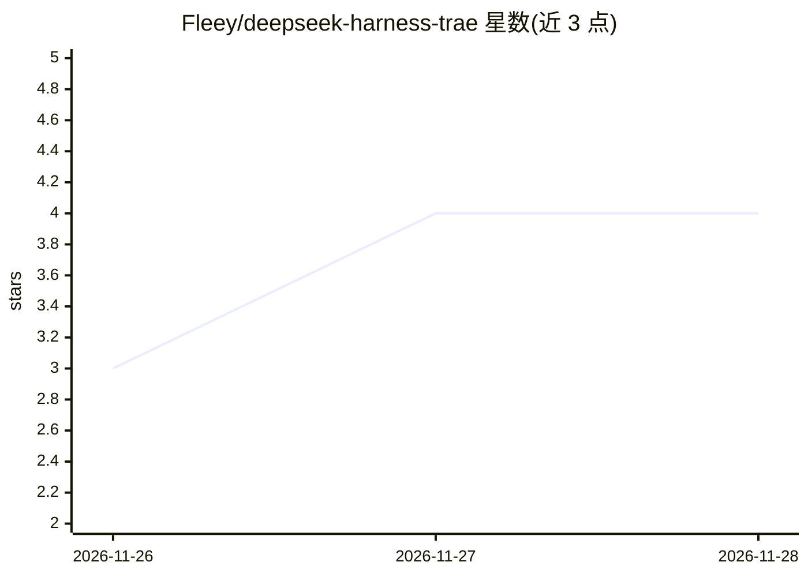

# Fleey/deepseek-harness-trae

⭐ 4 · JavaScript · 推送 2026-11-27 · [GitHub](https://github.com/Fleey/deepseek-harness-trae) · 个人维护 · 中文 README

**给 DeepSeek Harness 接入 Trae 企业版模型的插件**

dsh 插件，用 Trae 企业版个人访问令牌（PAT）换取 Cloud-IDE JWT 后直连 `llm_raw_chat` 接口，向 DeepSeek Harness 注册 Trae 模型来源，覆盖流式正文、thinking、function calling 与 token 用量。模型目录每次启动从上游接口动态拉取，traecli 缓存与内置 20 模型表兜底；提供 ToB/ToC 额度显示、思考档位切换、本地上下文预算、会话分享等功能。依赖已安装的 DeepSeek Harness 宿主，通过 `dsh plugin add` 安装。

## 筛选速览

| 维度 | 判定 | 备注 |
|---|---|---|
| AI 角色 | `ai-ecosystem` | LLM/agent 周边工具 |
| 许可风险 | `none` | — |
| 部署形态 | `library` | 以包/库形式分发 |
| 模型依赖 | — | README 未给出锁定关系 |
| 硬件要求 | — | 无带数字的原话,不猜 |
| 安装摩擦 | `low` | 无编译、无系统依赖或容器化 |
| 成熟度 | — | 结构信号不足 |

## 能力要点

- PAT 一项即可使用，直连 Trae `llm_raw_chat` 接口
- 模型目录启动时从上游拉取，退役模型自动移出选择器
- 支持企业席位与个人额度两路查询与剩余额度徽标
- 工具 schema 出口统一归一化 draft-4 以避免上游按批校验失败

## 适用场景

- 在 DeepSeek Harness 桌面/CLI 中直接调用 Trae 企业版订阅的模型
- 实时查看企业席位与个人额度包的已用/剩余
- 把 Trae 会话生成为可分享的网页链接

## 场景标签

`模型网关` · 领域:Agent 开发

## 证据(README 行号)

> L3: 一个 DeepSeek Harness（dsh）插件：在 Desktop / Web / CLI 里直接用 **Trae 企业版的模型**。
> L6: v0.3 起插件自己直连 Trae 的 `llm_raw_chat` 接口（和 trae2api 的 direct 模式同一套协议），
> L27: - 注册一个叫 **Trae** 的模型来源，直接走 `/api/ide/v2/llm_raw_chat`：流式正文、流式 thinking、

## 星数曲线

2026-11-26 3 → 2026-11-28 4（+1）

---
*卡片 v1 · prompt 1.4 · 生成 2026-11-26 · 置信度 mid · 依据 README sha `5bacfcc35fcb` · [字段定义](../../DATASET.md)*
