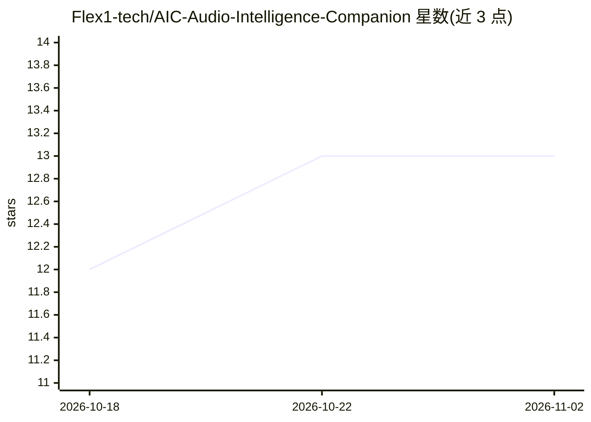

# Flex1-tech/AIC-Audio-Intelligence-Companion

⭐ 13 · Python · NOASSERTION · 推送 2026-10-28 · [GitHub](https://github.com/Flex1-tech/AIC-Audio-Intelligence-Companion) · 个人维护

**离线本地音乐推荐应用：MusiCNN 分析曲库并生成个性化播放列表**

面向个人用户的 100% 离线音乐推荐桌面应用：用预训练卷积网络 MusiCNN（msd-musicnn-1.onnx，经 ONNX Runtime 本地推理）对本地音视频库提取 200 维声学嵌入，存入嵌入式向量库 LanceDB，再以 MMR 算法在相似度与多样性间平衡生成播放列表。附加 BLAKE3 哈希去重、ffprobe 媒体验证、M3U/M3U8 导出与 VLC/系统播放器外部播放。Python 3.12 + Flet 构建，提供 Windows/Linux/macOS 预编译安装包；开发安装用 uv 或 venv。已知限制：首次索引逐文件顺序计算。许可证为 PolyForm Noncommercial，禁止未经授权的商业使用。

## 筛选速览

| 维度 | 判定 | 备注 |
|---|---|---|
| AI 角色 | `ai-native` | 本体是模型或模型工具 |
| 许可风险 | `none` | NOASSERTION |
| 部署形态 | `desktop` | 安装包/桌面程序 |
| 模型依赖 | — | README 未给出锁定关系 |
| 硬件要求 | — | 无带数字的原话,不猜 |
| 安装摩擦 | `medium` | 含编译或系统依赖之一 |
| 成熟度 | — | 结构信号不足 |

## 能力要点

- MusiCNN + ONNX Runtime 本地提取 200 维声学嵌入，无需联网或云服务
- LanceDB 向量存储 + MMR 算法生成兼顾相似度与多样性的播放列表
- BLAKE3 哈希去重与已索引文件 ffprobe 旁路，重扫描时间约降 90%
- 支持 mp3/flac/ogg/wav/m4a 及含音轨的 mp4/webm 容器

## 适用场景

- 在本地音乐库上离线生成按听感相似组织的播放列表
- 不想把音频数据上传云端的音乐爱好者做本地分析
- 从含音轨的视频归档中提取音乐并统一管理

## 场景标签

`推荐系统` · 领域:学习与行业

## 证据(README 行号)

> L21: Elle analyse votre bibliothèque multimédia à l'aide du réseau de neurones convolutionnel **MusiCNN**, extrait des r
> L81: * **Analyse acoustique locale** : extraction d'empreintes sonores basées sur le modèle MusiCNN pré-entraîné sans té

## 星数曲线

2026-10-18 12 → 2026-11-02 13（+1）

---
*卡片 v1 · prompt 1.4 · 生成 2026-10-31 · 置信度 mid · 依据 README sha `5481a5472089` · [字段定义](../../DATASET.md)*
