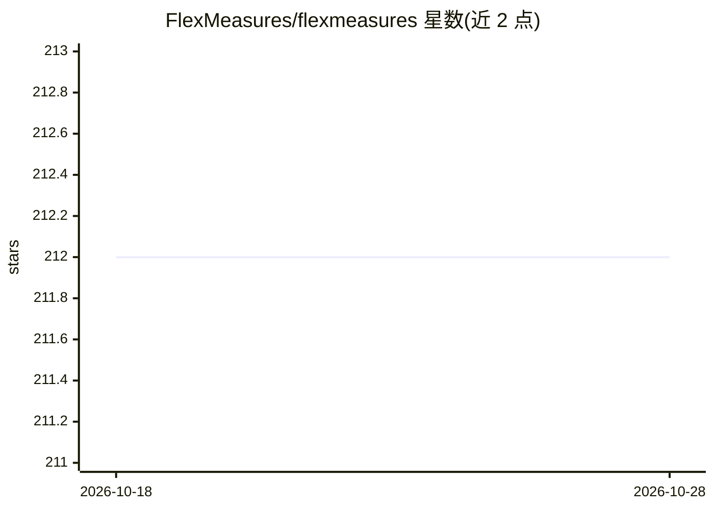

# FlexMeasures/flexmeasures

⭐ 212 · Python · Apache-2.0 · 推送 2026-10-27 · [GitHub](https://github.com/FlexMeasures/flexmeasures) · [官网](https://flexmeasures.io) · 组织维护

**能源柔性资产的实时调度与预测优化平台（EMS 后端）**

面向表后能源柔性的智能能源管理系统后端：读取时序数据，为电池、热泵、柔性工业流程等资产生成优化调度方案，并支持未来数小时的预测。基于 timely-beliefs 框架处理多来源、多分辨率与不确定性的数据建模，提供 API/CLI、插件扩展机制、含地图与图表的后台 UI 与多租户。由荷兰 Seita Energy Flexibility BV 维护，Apache2.0 许可，LF Energy 孵化项目。

## 筛选速览

| 维度 | 判定 | 备注 |
|---|---|---|
| AI 角色 | `ai-enhanced` | 去掉 AI 部分产品仍成立 |
| 许可风险 | `permissive` | Apache-2.0 |
| 部署形态 | `library` | 以包/库形式分发 |
| 模型依赖 | — | README 未给出锁定关系 |
| 硬件要求 | — | 无带数字的原话,不猜 |
| 安装摩擦 | `low` | 无编译、无系统依赖或容器化 |
| 成熟度 | — | 结构信号不足 |

## 能力要点

- 将数据转化为柔性资产的优化调度方案
- 基于 timely-beliefs 框架的数据建模（单位/分辨率/不确定性）
- 插件集成第三方数据源与协议（ENTSO-E、OpenWeatherMap、OpenADR）
- API/CLI、后台 UI 与多租户支持

## 适用场景

- 能源服务公司构建实时能源柔性应用与服务
- 工业企业内部数字化能源调度工具开发
- 为电池、热泵等资产做多价值叠加的排程优化

## 场景标签

 · 领域:能源/优化调度

## 证据(README 行号)

> L13: *FlexMeasures* is an intelligent EMS (energy management system) to optimize behind-the-meter energy flexibility.
> L45: - Forecasting for the upcoming hours

## 星数曲线

2026-10-18 212 → 2026-10-28 212（+0）

---
*卡片 v1 · prompt 1.4 · 生成 2026-10-22 · 置信度 low · 依据 README sha `fe1276826041` · [字段定义](../../DATASET.md)*
