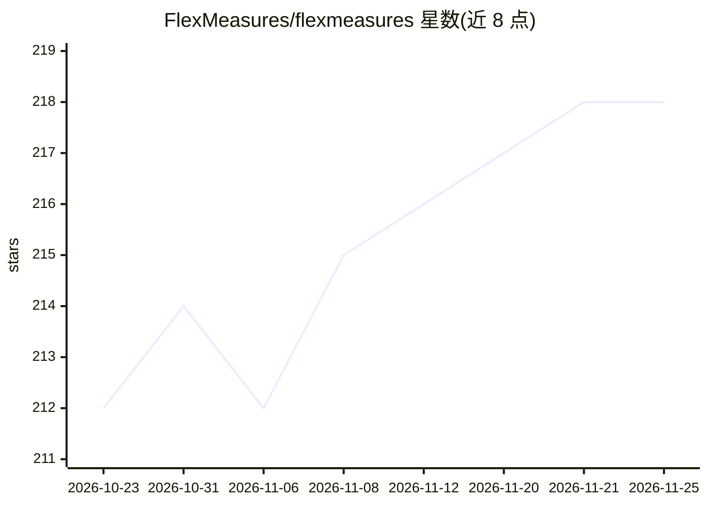

# FlexMeasures/flexmeasures

⭐ 218 · Python · Apache-2.0 · 推送 2026-11-23 · [GitHub](https://github.com/FlexMeasures/flexmeasures) · [官网](https://flexmeasures.io) · 组织维护

**能源 EMS 的调度优化与预测引擎：实时优化柔性资产**

面向能源管理系统（EMS）开发者的开源调度与优化引擎，支持电池、电动车、冷暖系统等多资产、多能源品种的实时优化调度，包含时序数据读取（API/CLI）、第三方数据源与协议集成（ENTSO-E、OpenWeatherMap、OpenADR）、未来数小时预测与柔性资产排程优化。基于 timely-beliefs 框架建模数据单位、分辨率与不确定性，提供插件机制、多租户后端 UI 与文档化 API。Apache2.0 许可，Linux Energy Foundation 孵化项目，由荷兰 Seita 维护。安装方式见文档的入门指南与 5 分钟教程。

## 筛选速览

| 维度 | 判定 | 备注 |
|---|---|---|
| AI 角色 | `ai-native` | 本体是模型或模型工具 |
| 许可风险 | `permissive` | Apache-2.0 |
| 部署形态 | `library` | 以包/库形式分发 |
| 模型依赖 | — | README 未给出锁定关系 |
| 硬件要求 | — | 无带数字的原话,不猜 |
| 安装摩擦 | `low` | 无编译、无系统依赖或容器化 |
| 成熟度 | — | 结构信号不足 |

## 能力要点

- 多资产、多能源品种的实时调度优化
- 基于 timely-beliefs 框架的数据单位/分辨率/不确定性建模
- API/CLI 读取时序数据，插件集成第三方数据源与协议
- 多租户支持与后端 UI（地图、图表）

## 适用场景

- 为电池、充电桩等柔性资产生成实时充放/用能调度
- 为 EMS 产品补充调度与优化能力
- 对能源时序数据做未来数小时预测
- 在企业场景下以多租户方式管理多账户能源数据

## 场景标签

 · 领域:能源/工业软件

## 证据(README 行号)

> L45: FlexMeasures is designed to make decisions based on data in an automated way. Data pipelining and dedicated machine
> L49: - Forecasting for the upcoming hours

## 星数曲线

2026-10-23 212 → 2026-11-25 218（+6）

---
*卡片 v1 · prompt 1.4 · 生成 2026-11-25 · 置信度 mid · 依据 README sha `18410e254cb1` · [字段定义](../../DATASET.md)*
